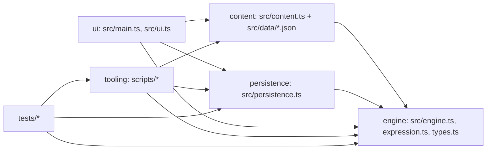

<!-- Generated by DeepInit 0.7.2 · run deepinit-20261021T205954Z · 2026-10-21. Regenerated on each run; do not hand-edit. -->
# Technical dependencies

## Component graph

There are no cycles. `src/engine.ts` imports only `./expression` and `./types`. Content is plain JSON concatenated in a fixed order by `src/content.ts:7-8`. [HIGH]

| From | To | What | Evidence |
|---|---|---|---|
| ui (`main.ts`) | content, engine, persistence | `records`, `GameEngine`, `decodeSave`/`makeSave`/`SaveStore` | `src/main.ts:1-4` |
| ui (`ui.ts`) | engine, content | `WAITING_MAX`, `GameEngine`, `openingContext` | `src/ui.ts:1-3` |
| tooling | engine, content, expression | validator and routes | `scripts/validate.ts:1-6` |
| ui → content ids | **implicit** | hardcoded record ids, not type-checked | `src/ui.ts:45`, `src/ui.ts:907` |
| ridge/shared content → opening ids | **implicit** | gates naming opening record ids | `src/data/ridge.json:141`, `src/data/ridge.json:301` |

## External dependencies

| Package | Version | Use | Source |
|---|---|---|---|
| Bun | 1.4.0 (runtime/test/bundler) | build, serve, test | `package.json` scripts |
| typescript | 7.0.2 (dev) | `tsc --noEmit` | `package.json` |
| playwright | 1.64.1 (dev) | browser smoke | `scripts/browser-smoke.ts:1` |
| @types/bun | 1.4.3 (dev) | types | `package.json` |

There are no runtime dependencies: the shipped bundle is the game code only (`scripts/build.ts:9-15`). Browser APIs used: IndexedDB (`src/persistence.ts:269`), Web Locks (`src/main.ts:161`), localStorage (`src/ui.ts:98`). [HIGH]
