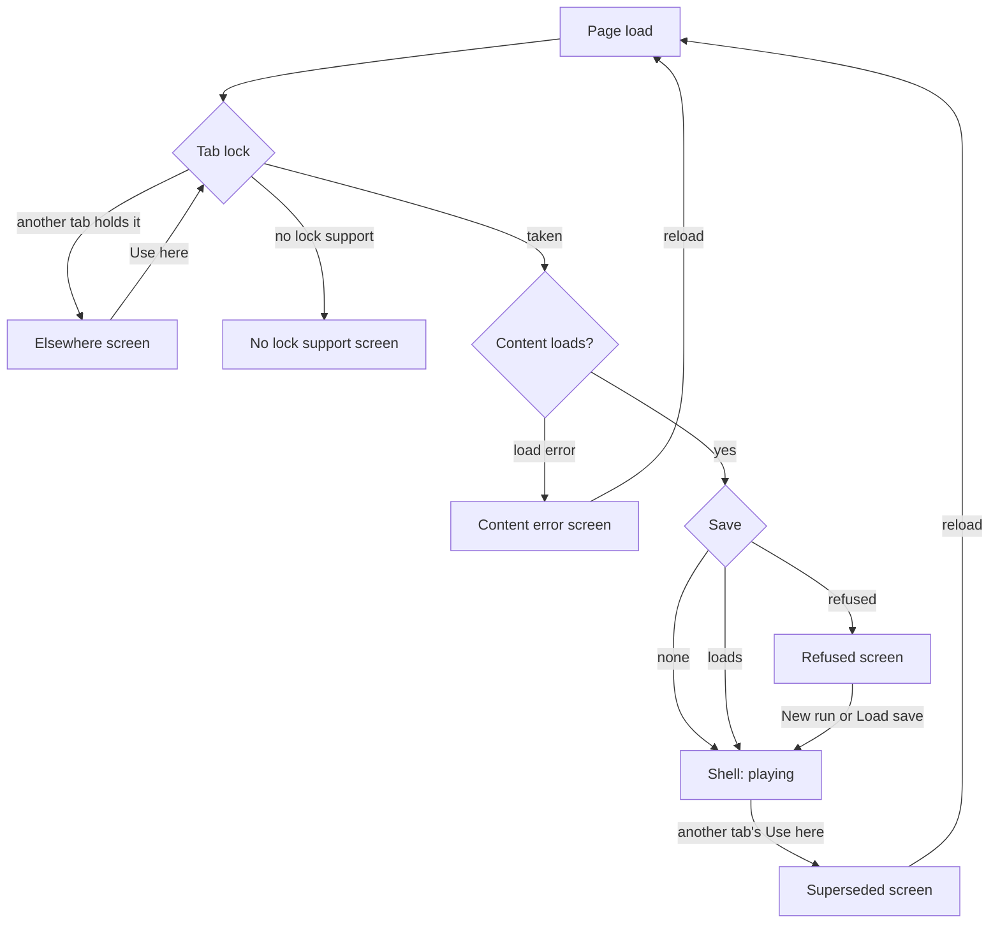

# UX Spec: Interface Shell and Goal Line

> **Status**: Approved 2026-11-21 (lean `/ux-review`; findings in `design/ux/reviews/interface-shell-review-log.md`)
> **Author**: designer + Claude (`/ux-design interface-shell`)
> **Last Updated**: 2026-11-21
> **System**: #13 in `design/gdd/systems-index.md` (MVP, UI)
> **Journey Phase(s)**: the whole MVP run: the first screen, choosing a method, gathering, forging, after the forge, and coming back. No player journey map exists yet (Open Questions 1)
> **Platform Target**: web browser, desktop first. Phone width (390 px design width; the layout holds at 320 px) is a layout constraint from the MVP. Phone layout (#17) delivers the phone layout itself at the vertical slice. Inputs: mouse, keyboard and touch. No gamepad
> **Template**: UX Spec
> **Implements Pillar**: 4 (No dead ends, no attention tax); supports 1 (The forge is the milestone), 2 (Methods matter) and 3 (The build is a problem)
> **Binding inputs**: systems index rationale 13, row 13 and the risk register's Interface shell row; the concept's pillars, Visual Identity Anchor and MVP required item 8; GDDs #1–#11 (all Approved)
> **Aligned with**: Method marks (#14, `design/ux/method-marks.md` D3, BD2, BD6, glyph sheet, Transitions), on the designer's decisions taken in #14's session (2026-11-21)
> **Amendments made with this spec** (designer-approved 2026-11-21): #1 A8 (`source.group`) and A9 (the `opened` event); #11 A1 (the storage request becomes a menu action); #8 A2 and #9 A3 (group values, Open Questions answered); status edits to #3, #4 and #10; two concept rewordings. Requirement Trace lists each

Rule numbers ("rule 32") refer to `research/arcanum-reference/12-design-rules.md` (1–38, 70–74),
`research/hundred-days-reference/06-design-rules.md` (39–69) and
`research/magic-research-2-reference/08-design-rules.md` (75–100). "#n" is a system in the
systems index. Quoted player-facing text is provisional copy, checked by review (Acceptance
Criteria, last group).

---

## Purpose & Player Need

**The player arrives wanting to know what the game asks of them, what is running, and what to do
next.** The shell is the frame every other screen sits in, and it holds the run's persistent
context. Without a tap, it answers five questions at every moment:

1. **What am I trying to do, and how far am I?** The goal line: the forge's four slots, the three
   doors and the seals they can earn (rule 99; concept, Flow State Design).
2. **What is running, and when does it stop?** The running line (rule 23; #4).
3. **What do I hold, against what I can hold?** The stores (rules 18, 32; #3).
4. **Which method am I circulating?** The method's name, glyph and tint (rule 71; Visual Identity
   Anchor).
5. **What just happened, including while I was away?** The log, the one event channel (rules 68,
   99).

It also shows, for every source on the road and before any tap, whether that source can run now,
and if not, why, in words (rules 2, 34; #4 UI Requirements).

**Why it exists.** The forge prototype's one tester lost a whole run to not understanding the task
(systems index, risk register). The MVP's first judged signal is "States the goal": within two
minutes of starting, the tester can say what they are trying to do (concept, MVP Definition). The
shell carries that signal with a goal line and three lines of instruction on the first screen. The
goal line is a picture first and words second: "Text supplements this; it does not carry it"
(concept, Flow State Design).

**What would go wrong without it.**

- Each system would show its own notices. Hundred Days' first screen has three permanent strips, a
  toast, a news ticker and a hint band competing for attention (rule 68).
- The running activity and the stores would leave the screen whenever the player looks at the
  forge, so the player would have to find the button that started something to understand what is
  happening (rule 32).
- The 30-second loop's switches would become an attention tax: a stop the player has to watch for
  (pillar 4).

**What it holds and what it does not.** The shell holds no rules. The systems index says "The three
interface systems read gameplay state and own no rules" (Relationship analysis). The shell reads
state and calls pure functions of the rules core. It sends the player's actions to the rules core
and displays the typed events the rules core emits. Its own state (the open card, the centre view,
the log buffer) is interface state, and it is never saved.

**Player-need test.** A new player who has read nothing can say, from the first screen and without
leaving it: "I forge something from four of these six ingredients, three doors score it, and first
I choose a method" (AC-13-01).

---

## Scope, Seams and Reference Rules

### What this spec owns

- The frame: its zones, the wide and narrow layouts, and what never leaves the screen.
- The goal line and the instruction lines.
- The running line, held breath and stop reasons, as displayed.
- The stores, key items and ingredients as persistent context.
- The road: its grouping, the source row, the ladder block, and the row states and their words.
- The one detail container (the tooltip), how it opens, and the order of fields inside it
  (rule 33).
- The dialog container that every confirm uses, the Forge screen's (#15) included.
- The display of the event channel: the log, the away summary and the notice strip.
- The session screens of #11: Loading, Elsewhere, Superseded, Refused, Content error and No lock
  support.
- The menu: New run, Copy save, Load save, and Keep my save in this browser.
- Number and duration formats (#1, "Formulas owned by other systems"; #7 Y2).

### Seams with the other interface specs

| With | This spec owns | The other spec owns |
|---|---|---|
| Method marks and number breakdowns (#14), written in parallel | The detail container: how it opens (tap, click or Enter on a record), where it sits, its drill-down stack and back line, how it closes, focus, line size. Which fields a card shows, and in what order. What opens it: records only (a source's name, a store, an ingredient, a door, the goal line, the method chip, the running line), never a number or a mark (#14 D3) | What a number breakdown shows inside the container, under each rule-derived number's own line: the base, each stage and its source, a clamp read as a limit (#2 P8), and a composed number's part lines (#14 BD1–BD9). What a method mark looks like on any value (in a row, a card or the goal line) and how it shows direction. The glyph sheet: each method's glyph, solid when circulating and hollow otherwise, and the neutral closed, heap and limit glyphs. **This spec designs none of #14's contents.** It reserves the space, hands the value to #14's renderer, and places #14's solid glyph on the method chip and its heap glyph on the heap toggle |
| Forge screen (#15, `design/ux/forge-screen.md`, Scope, Seams and Reference Rules) | The Forge view's place in the frame: a centre view beside the Road, with its own tab. The switch to the Road after the commit. The goal line and the instruction lines after the Wave A checkpoint. The dialog container. The persistent display of the Foundation (#6 UI flag) | Everything inside the Forge view: the method-choice view, the commit dialog's contents, plans, previews, the headroom signal, the forge confirmation, the forge's visual event, the `lastRun` line, and the accent before the commit |
| Phone layout (#17), vertical slice | The narrow layout's zones, components and limits, which are a constraint from the MVP | Delivery and polish at the vertical slice. #17 may refine this layout. It may not take a rule 32 item off the narrow screen without amending this spec |
| Accessibility and settings (#18), vertical slice | The accessibility floor stated under Accessibility | The tier, the settings (themes, text size), and everything beyond the floor |

**The Wave A hand-over.** At the forge-and-methods checkpoint the shell does not exist yet, so the
Forge screen (#15) carries the goal line and the first-screen instruction (systems index,
Overview). #15 builds them from this spec's components, Goal line (C1) and Instruction lines (C2),
not its own, so the player relearns nothing when the shell lands. When it lands, both move into the
goal band, and #15 drops its copies.

### Reference rules

Read before writing: `research/arcanum-reference/01-shell-and-layout.md` and
`02-interaction-semantics.md`, and Magic Research 2's `01-shell-and-opening.md`. Each divergence
from a *copy* rule is stated, with its reason, in the right-hand column.

| Rule | Source, tag | In this spec |
|---|---|---|
| 1 One vocabulary; render by field | Arcanum, copy | Cards render by field, in one order (#1 UI Requirements) |
| 2 Visibility is not actionability | Arcanum, copy | Every revealed source is listed, and its row says in words what is missing |
| 8 Sections are records | Arcanum, copy | **Diverged.** There are two fixed centre views, Road and Forge. Reason: the MVP has two screens and unlocks no section, so a section record type would be sprawl (anti-pillar). Revisit when a realm adds a screen (#19) |
| 23 One slot, rest fills it, fill stops it | Arcanum, copy | The running line shows rest as the slot's own occupant |
| 27 Leaving keeps progress | Arcanum, copy | Kept progress shows as a partial bar on its row |
| 32 Persistent context | Arcanum, copy | The goal band, the method, the running line and the stores never leave the screen, at any width. The log never leaves the wide screen. **Diverged on narrow widths, for the log only:** its newest line stays pinned, and the whole log is a tab. Reason: 390 px. Arcanum's vitals and quickbar have no counterpart in the MVP |
| 33 One tooltip schema | Arcanum, copy the schema; beat hover-only | One detail container, opened by tap, click or Enter. Hover shows nothing |
| 34 Classify by timing | Arcanum, copy | Timed sources show a duration. Rest shows none, and reads "Resting" |
| 35 Owned stays visible | Arcanum, judgement call | Key items stay in the stores as "held", and forged ingredients stay listed as "in the Foundation" |
| 37 Desktop-only layout | Arcanum, beat | A narrow layout from the MVP |
| 38 Irreversible actions confirm | Arcanum, beat | Every irreversible action says what it clears: New run and Load save here, the commit and the forge in #15 |
| 54 Irreversible choices say what they close | Hundred Days, copy | The new-run dialog names the method and the Foundation it clears |
| 58 Closed lists for free-text enums | Hundred Days, copy | `source.group` is free text, but a group of one source is a load error (#1 A8), so a typo cannot open a group of its own |
| 66 Search once a list passes ~50 records | Hundred Days, copy | Not needed: the MVP road has 23 sources |
| 67 A phone layout is not optional | Hundred Days, avoid the reference | The narrow layout is specified now |
| 68 One notice channel | Hundred Days, avoid the reference | One log and one notice strip. No toasts, no tickers, no pop-ups |
| 70 Flavour comments on the mechanic | Arcanum, copy | `flavor` comes last in a card, and in the ladder beats' log lines |
| 71 Identity lives where the numbers live | Arcanum, copy | The method's tint appears only on the method chip and on values the method changed (#14) |
| 97 Every number explains itself | Magic Research 2, copy | Every rule-derived number in a card shows #14's breakdown under its own line, already expanded. **Diverged, with #14 (its D3):** the breakdown is reached through the record, not by tapping the number. Reason: dense rows at 390 px cannot give each number a 44 px target (rule 67) |
| 98 A phone layout is achievable | Magic Research 2, copy | The bottom tab bar is copied. **Diverged:** there is no resource drawer and no bell. Reason: rule 32 wins, so the stores stay on screen as chips |
| 99 One goal line, one event channel | Magic Research 2, copy | The goal line names the next step, and every unlock is a typed event that stays readable in the log. There are no pop-ups, so nothing needs suppressing |

---

## Player Context on Arrival

| Arrival | When | Just before | State of mind | What the shell must give |
|---|---|---|---|---|
| **The first screen** | Page load with no save: a run start, in the Choosing phase (#11 D6.1) | Nothing: the player opened the page | Curious. The player may expect Arcanum's density, or an idler that plays itself. This is the player at risk of the prototype's lost run | The goal line and the three instruction lines. Both methods, side by side, on the Forge tab, which opens first. Nothing urgent: the slot rests and banks breath while they read (#4 S8.6, #7 W10) |
| **After the commit** | The `committed` event | The run's first weighty choice, in #15's dialog | Purposeful. Wants to see what the method changed | The tint lands, and the centre switches to the Road, where the method's routes have opened and the other method's routes read as closed (#7 Game Feel). The next-step line names what to do |
| **The 30-second loop** | Committed, while gathering | A stop, or a store filling | Semi-active. Switches every 20–40 s (#3 Game Feel) | The stop reason on the running line, the stores against their caps, and each row's state before any tap. A late tap costs nothing (#4 S8.6), so there is no urgency cue |
| **Four ingredients in hand** | Committed, with at least N ingredients held | A recipe or route paid an ingredient | Planning | The next-step line sends them to the Forge tab |
| **After the forge** | The `forged` event | #15's confirmation | Satisfied, or reflective | The Foundation on show in the goal line, each door's tier and flavour, and the way to try the other method (a new run) |
| **Coming back** | Page load with a save, or a hidden tab shown again after a long gap | Time away | Wants to know what happened | The first paint already shows the stores, the stop reason and the held breath (#4 Game Feel). The log leads with the away summary |
| **A session screen** | Another tab holds the game, the save is refused, or the content fails to load | Opening the page | Confused, or worried about the save | One plain sentence and the way out (#11 UI Requirements) |

**Emotional assumption: calm, never hurried.** Nothing rewards being present at a particular moment
(pillar 4). The shell therefore uses no urgency cues: no flashing, no alarm colours, and no sound
(#4 Game Feel: "The interface never needs urgency cues, flashing or a sound on a stop").
Countdowns inform; they never threaten.

**Voluntary arrival.** The shell is the game, and the player arrives by opening the page. The game
moves the player once: to the Road, in the frame of the commit.

**Alternatives considered for the first screen.**

- **A tutorial modal or a guided overlay.** Magic Research 2 shows its opening events as modals.
  Rejected: a modal is a pop-up on the channel rule 68 keeps clear, and players dismiss it before
  reading it. The goal line stays on screen instead.
- **Guide quests as paid content** (rule 61). Deferred: the MVP has one realm and one forge, and
  the goal line is its guide. Revisit if a tester fails "States the goal".
- **A title screen or main menu before play.** Rejected: it costs a click and teaches nothing.
  There is one save slot (#11).

---

## Navigation Position

**The shell is the root.** There is no title screen and no main menu. This screen lives at:
page load → session gate (#11 D3, D8) → shell.



Inside the shell:

- **Centre views.** The Road, the default after the commit, and the Forge, #15's screen and the
  default before the commit. On narrow widths a third tab, Log, holds the whole log.
- **Overlays.** The detail container (a card, or a sheet on narrow widths), the menu, and the
  dialogs. An overlay never covers the goal band. On narrow widths the sheet stops below the pinned
  header (rule 32).
- **Full screens.** The session screens replace the whole shell. They are the only places where
  the persistent context is absent, because they have no run to show.

---

## Entry & Exit Points

| Entry source | Trigger | Player carries this context |
|---|---|---|
| Page load, first game | No record in storage (#11 D3.3), so a run start (D6.1) | Nothing. The Choosing phase, the Forge view, and the log line "A new run begins." |
| Page load, a save | #11 D3 loads it | The run, the load notice if any (D3.14), and the away summary for the gap |
| Page load, a refused save | #11 D3 refuses it | The Refused screen, naming what was found |
| Page load, a content error | #1 R8 load error | The Content error screen. Nothing is written |
| Page load, another tab plays | #11 D8.2 | The Elsewhere screen |
| Use here | #11 D8.3 | Loading, then the run, as on a page load |
| A hidden tab shown again | `visibilitychange` or `pageshow` (#4 S9.3) | The run, advanced before the first paint, with an away summary if the gap was at least `AWAY_SUMMARY_MIN_MS` |
| New run confirmed | The menu, or the Refused screen (#11 D6.2) | A fresh run in the Choosing phase. The log is cleared to "A new run begins.", and the Forge view opens |
| Load save confirmed | The menu, or the Refused screen (#11 D9.2) | The imported run, and the Forge view opens. Its gap since its own `lastSeen` plays as away time, with its away summary |

| Exit destination | Trigger | Notes |
|---|---|---|
| Closed or hidden page | The browser | Not irreversible. The page-hide write keeps the run (#11 D2.2) |
| A new run | Menu → dialog → Confirm | **Irreversible.** It clears the method, the Foundation and its seals, everything held, kept progress and held breath. The dialog names each (#11 D6.2) |
| An imported run | Menu → dialog → Confirm | **Irreversible.** It replaces the whole save, `lastRun` included. The confirm names the run it replaces (#11 D9.3) |
| Superseded | Another tab's Use here | This tab goes inert. A reload returns through the session gate |
| Road ↔ Forge | A view tab | Nothing changes but the view |

There is no quit button and no "back to menu". Closing the tab quits.

---

## Layout Specification

### Information Hierarchy

Ranked by what the player must read first. The rank sets prominence, not position.

| Rank | Item | Why this rank | Zone |
|---|---|---|---|
| 0 | A session notice, only while one is present: "Not saving", "This browser is not keeping your save", an internal error | A save at risk outranks play (#11 J5, D10) | Notice strip |
| 1 | **The goal line** | The task the prototype's tester never understood (risk register) | Goal band |
| 2 | **The next-step line**, and before the commit the two lines above it | Rule 99: the goal line names the next action | Goal band (narrow: content top before the commit) |
| 3 | **The running line**: what runs, when it stops, the breath held | One slot; the stop that drives the 30-second loop (#4) | Goal band |
| 4 | **The stores** against their caps, with "full" | What can be spent now (rule 18) | Store column; chips on narrow |
| 5 | **The road rows**: each source's state and reason | The next action, chosen before a tap (#4 UI) | Centre |
| 6 | **The method**: name, glyph, tint | Identity, which changes once per run | Goal band |
| 7 | **The log** | What just happened | Log column; a tab and a pinned line on narrow |

**Discoverable on a tap** rather than shown: every detail card (a source's full bill, fights and
flavour), every number's breakdown (#14), instruction lines 1–2 after the commit, the Foundation's
affinities and stats, and the method's opens, closes and redo line.

### Layout Zones

The page never scrolls as a document. Each zone scrolls inside itself, as in Arcanum's frame
(`01-shell-and-layout.md`, "The frame").

**Wide (at least `WIDE_MIN_PX`, 960 px):**

| Zone | Place | Contents | Scroll |
|---|---|---|---|
| Z1 Goal band | Full width, top, fixed | Row A: goal line (C1), method chip (C3), menu (C4). Row B: instruction lines (C2): three before the commit, one after. Row C: running line (C5) | Never |
| Z2 Notice strip | Full width, under Z1 | Session notices and the load notice (C6). No height when empty | Never |
| Z3 Store column | Left, 232 px | Stores (C7), then ingredients (C8) | Inside |
| Z4 Centre | Fluid, at least 440 px | View tabs Road · Forge (C9). Road: post-forge note (C13), groups (C10–C12). Forge: #15 | Inside, per view |
| Z5 Log column | Right, 272 px | The log (C14), newest first | Inside |

**Narrow (below 960 px; designed at 390 px, holds at 320 px):**

| Zone | Place | Contents | Scroll |
|---|---|---|---|
| N1 Header | Pinned top | Row A: goal line compact (C1), method chip (C3), menu (C4). Row B, after the commit: the next-step line (C2). Row C: running line (C5), at most two lines. Row D: store chips (C7), wrapping | Never |
| N2 Notice strip | Pinned under N1 | As Z2; the load notice folds to one line with Details | Never |
| N3 Content | Between N2 and N4 | Before the commit, the instruction block (C2) heads every tab. Then the tab's view: Road, Forge or Log | Inside |
| N4 Pinned log line | Above N5 | The newest log entry, one line (C15) | Never |
| N5 Tab bar | Pinned bottom | Road · Forge · Log (C9) | Never |

**Height budget on narrow.** At 390 × 844, N1 + N2 (with no notice) + N4 + N5 together take at most
45% of the viewport height after the commit, so the content zone keeps at least 460 px. Before the
commit the instruction block scrolls with the content, which keeps the pinned header the same
height in every phase. The budget is checked by AC-13-24.

**Short viewports** (AR-V4.4; designer, 2026-11-21). At 640 × 360 CSS px (a 1280 × 720 window at 200% zoom), and at any larger viewport, every function stays reachable, and the pinned zones with no notice take at most half the height. A narrow viewport at least 640 px wide and shorter than 600 px folds the pinned zones:
- Row D's store chips become one row that scrolls sideways inside itself. The page never scrolls sideways, and below 640 px wide the chips wrap as before (AR-V4.2).
- Row C, the running line, takes one line: the occupant, the bar, "{countdown} · stops {countdown}", the breath and Stop. It wraps to a second line before it drops a figure (#4 UI Requirements).
- N4, the pinned log line, hides. The Log tab keeps every entry.

This diverges from rule 32 (*copy*), stated: a store chip can scroll out of sight inside its row, and the newest log line leaves the screen. Three rows of two-line chips and the log line cannot stay pinned in 360 px and still leave half of it to the content. The wide layout pins only the goal band (Z1) and is not folded. Viewports shorter than 360 px are #17's (Open Questions 12). AC-13-38 checks the budget.

**Ingredients on narrow.** The goal line's slots show how many ingredients are in hand, and the Goal
card lists all six with their marks. The full list with contributions is the Forge view's (#15).
This keeps every ingredient one tap away while the header stays within its budget.

### Component Inventory

The Pattern column names the pattern in `design/ux/interaction-patterns.md`.

| ID | Component | Zone | Type | Shows | Interactive | Pattern |
|---|---|---|---|---|---|---|
| C1 | Goal line | Z1 / N1 | Composite display | N slots, the doors in order, the seal total; after the forge, the Foundation | Tap: Goal card | #13 single-use (library catalogue) |
| C2 | Instruction lines | Z1 / N1, N3 | Text | Three lines before the commit, then the next-step line | No (C1's card repeats them) | #13 single-use (library catalogue) |
| C3 | Method chip | Z1 / N1 | Glyph and label | "No method yet"; after the commit, the method's glyph, name and tint | Tap: Method card | IP8 |
| C4 | Menu | Z1 / N1 | Menu button and list | New run…, Copy save, Load save…, Keep my save in this browser | Yes | IP5 |
| C5 | Running line | Z1 / N1 | Status line with bar | The occupant, progress, countdowns, held breath, "Heaped", the last stop reason | Stop; tap elsewhere on it: Running card | #13 single-use (library catalogue) |
| C6 | Notice strip | Z2 / N2 | Stack of notices | "Not saving", "This browser is not keeping your save", an internal error, the load notice | Copy save, Copy report, Dismiss, Details | #13 single-use (library catalogue) |
| C7 | Store row (wide) / store chip (narrow) | Z3 / N1 | Stat display | Name, held / cap, a bar (wide), "full" with its glyph; a key item as "held" or "not held" | Tap: Store card | #13 single-use (library catalogue) |
| C8 | Ingredient row | Z3 | Stat display | Name and "in hand", "not yet" or "in the Foundation" | Tap: Ingredient card | #13 single-use (library catalogue) |
| C9 | View tabs | Z4 / N5 | Tab list | Road · Forge (wide); Road · Forge · Log (narrow) | Yes | IP4 |
| C10 | Group heading | Z4 / N3 | Heading | The group's `source.group` text | No | #13 single-use (library catalogue) |
| C11 | Source row | Z4 / N3 | List row | State glyph, name, output, bill, duration, fight result, kept progress, reason; heap toggle on gatherers; Start when Ready | Name: Source card; toggle; Start. Numbers are not targets | IP13; its heap toggle (C11a) IP14 |
| C12 | Ladder block | Z4 / N3 | Grouped rows | A rail, the floors in order, depth glyphs, a break at a sealed floor; one closed row when every floor is closed | As C11 | #13 single-use (library catalogue) |
| C13 | Post-forge road note | Z4 / N3 | Text | One line once the realm is forged | No | — |
| C14 | Log | Z5 / N3 (Log tab) | Live list | Entries, newest first; the away block | Scroll only | IP17, IP18 |
| C15 | Pinned log line | N4 | Text | The newest entry, or the away block's header | Tap: Log tab | IP17 |
| C16 | Detail container | Overlay | Anchored card (wide) / bottom sheet (narrow) | A card in rule 33's field order, with #14's breakdown under each rule-derived number; a drilled frame under its back line | Close, the back line, part lines (›), records named inside | IP1, IP2 |
| C17 | Dialog container | Overlay | Modal dialog | New run, Copy save, Load save; #15's commit dialog and forge confirmation | Yes | IP3 |
| C18 | Session screens | Full screen | Text and buttons | Loading, Elsewhere, Superseded, Refused, Content error, No lock support | Per screen | IP19 |

#### C1 Goal line

- **Before the forge**, from left to right:
  - **Slots.** N slot glyphs (N is `realm.makeupSize`, 4). One slot fills for each ingredient in
    hand, up to N: filled = min(k, N), where k is the number of ingredients held. The label reads
    "{k} of {M} in hand" (M is the length of `realm.ingredients`, 6). A slot never names an
    ingredient, because which four to forge is the plan, and the plan is #15's.
  - **Doors.** An arrow, then each door of `realm.doors` in order, by name, each with two empty seal
    glyphs: "Furnace Gate ○○".
  - **Seals.** "up to {2D} seals", where D is the number of doors.
- **After the forge**, read from the snapshot (#6 G10, G13.3):
  - the four forged ingredients by name (wide) or by count (narrow);
  - each door with its tier as a word and a glyph: shut ○○, open ●○, wide open ●● (#6
    Visual/Audio: "never by hue alone");
  - "{s} of {2D} seals".
- **Never shown here:** a preview of any makeup's seals, the headroom signal, or a recommendation.
  All three belong to the Forge view, under #6 G7's preview rule and #15.
- **Tap opens the Goal card.**
  - Before the forge: the three instruction lines, the six ingredients with their marks, and each
    door's name and `desc`.
  - After the forge: the Foundation, which has the four ingredients, the four affinities by name
    and glyph with their stats (#6 Visual/Audio: each also names its stat), each door's tier and
    `flavor` (#6 G13.4), and the seal total. Every number shows its breakdown under its own line,
    and the seals, each door's score and each stat drill down (#14 BD5, BD6).
- #15's Plan card (FC8f) uses this layout, reading each number from `preview` instead of the forge snapshot.
- The doors' `flavor` names what lies beyond each door. It appears in the Goal card only once the
  realm is forged (#6 G13.4).

#### C2 Instruction lines

Shell strings. Each number comes from a realm field, so the text stays true if content changes.

1. "Forge a Foundation from {N} of these {M} ingredients."
2. "{D} doors test it with a fight each: shut, open or wide open, for up to {2D} seals."
3. The next step, chosen by the run's phase alone:

   | Phase | Line 3 |
   |---|---|
   | Choosing | "First, on the Forge tab, choose a method and begin circulating it." |
   | Committed, fewer than N ingredients in hand | "Next: gather ingredients on the road. Each one shows what it gives once in hand." |
   | Committed, at least N in hand | "Next: compare makeups on the Forge tab, then forge." |
   | Forged | "Forged: {s} of {2D} seals. A new run can try {other method}." |

- **Folding.** All three lines show before the commit. From the `committed` event on, only line 3
  shows, and lines 1 and 2 move into the Goal card (designer, 2026-11-21).
- **No steering.** A line names a step, never a source, an ingredient or a makeup (#10's no-steering
  rule; #6 G7.4: the headroom signal never names a makeup).
- **The forged line** frames the other method as a comparison, never as a best to beat (#11
  CD-GDD-ALIGN advisory). With exactly one other method, `{other method}` is its name; with more,
  it reads "another method".

#### C3 Method chip

- Before the commit: a neutral glyph and "No method yet". The shell sets no accent before the commit,
  because #15 owns the accent before the commit.
- After the commit: the method's solid glyph from #14's glyph sheet, its name and its tint (#14
  MK9). It is the interface's only accent (Visual Identity Anchor, principle 1), and the glyph
  carries the meaning in greyscale (principle 3). The neutral glyph before the commit is this
  spec's and stays distinct from every #14 glyph (Open Questions 3). The name is in ink; a tint colours text only where it keeps 4.5:1.
- Tap opens the Method card: `desc`, the closes list (`closesLines`, #1 R7.2), the redo line (#7 Y2:
  "Redo: only by starting a new run"), and "{other method}: closed for this run. A new run can
  choose it." The other method stays readable (#7 UI Requirements 4).

#### C5 Running line

- **Occupant:** the source's name, or "Resting" with the rest glyph (#4 Visual/Audio). Only the
  running line uses the rest glyph.
- **While running:** the unit's progress bar, *p* / *D*, painted every frame. "next in {countdown}"
  for the unit, and "stops in {countdown}" for the run (#4 F4, F5). "Heaped" when the running
  gatherer is heaped. A **Stop** button: one tap, with no confirmation (#4 S3.2, Game Feel).
- **Held breath:** "Breath {m:ss}", with "×2" while it is being spent and "full" at `BANK_CAP` (#4
  S8, UI Requirements). Shown in every phase, so a player deciding before the commit can see that
  deliberating costs nothing.
- **While resting after a stop:** "Resting · {source} stopped: {reason}", from the saved last stop
  reason (#4 S12). It stays until the next Start.
- **Tap anywhere on the line except Stop** opens the Running card. It shows the countdown split into
  real time at double speed and real time at single speed (#4 F5), the units to the stop (F4), and
  one line on rest: "Rest banks up to 30 min of breath. A run spends it at double speed."
- **#10 Open Question 5, answered:** the running line shows the heap state as a word and carries no
  toggle. The toggle lives only on the gatherer's row, so each gatherer has exactly one control, and
  the state is still visible wherever the eye is.

#### C7, C8 Stores, key items and ingredients

- **Which stores show (#3 UI Requirements, left to #13):** every store that the inputs or outputs of
  a revealed source name. All fourteen hearth sources are revealed from the run start (#8 L3.5), so
  in the MVP all eight stores show from the first screen. The rule is stated generally so later
  realms follow it.
- **Order:** spendable stores in content order, then key items (a key item is a store whose base
  cap is 1, #3 K1.1).
- **A spendable store (wide):** "{name}", a bar of held against cap, and "{held}/{cap}". When full,
  the full glyph and the word "full" (#3 Visual/Audio). No hue.
- **A key item:** "{name}" with a glyph and "held" or "not held" (#3 UI Requirements).
- **A store chip (narrow):** two lines, name over "{held}/{cap}", or the key item's word. Chips wrap
  in rows of three at 390 px and grow taller rather than truncate a name.
- **Ingredients (wide only):** the six in `realm.ingredients` order: "in hand", "not yet", or, after
  the forge, "in the Foundation" for the four forged. Tap opens the Ingredient card.
- **A cap change** (`capChanged`) repaints the cap in the same frame, with no effect. The forge's
  moment is #15's (#3 Visual/Audio). The player feels the raise as room: a full store stops being
  full (#3 Game Feel).

#### C10–C13 The road

- **Grouping (#8 Open Question 5, answered: by line).** Each source carries `source.group`, a
  display-only heading (#1 A8). Sources with the same text form one group. Groups appear in the
  order of their first source in content, and rows in content order. The MVP's groups, authored
  with #8's and #9's content:

  | Group | Sources |
  |---|---|
  | Fuel | Skim the Ash Pits, Render Tallow, Kindle the Hearth Lamp |
  | Timber | Fell Ironbark, Season Planks |
  | Stone | Quarry the Jade Seam, Carve Jade Blanks, Tune the Chisel |
  | Recipes | the six recipes, one per ingredient |
  | Hunts | the six hunts |
  | The Still Deep | Still Deep I, II and III |

- **Every revealed source is listed** in every phase, closed ones included (rules 2, 35). Hidden
  sources are never listed (#1 F7). The MVP has none.
- **The source row (C11)** is one flowing line that wraps at most once, with the controls on the
  right of its first line:
  - the state glyph, then the name (a button that opens the Source card);
  - for a source whose output is an ingredient: "→ {ingredient}";
  - the bill: "{input} ×{n}" for each input. When the bill is short, the shortfall follows it,
    "(k more)", in #1 F4's form;
  - for a hearth source, its outputs: "→ {output} {n}";
  - the duration, in the duration format;
  - for a fight source, the exact result from #5 C9: the verdict word with a neutral glyph, then the
    Life kept with its base: "wins, keeps 46 of 100 Life" (#9 UI Requirements 1). The creature, the
    four stats on each side and the decider open in the card (#9 UI Requirements 1; rule 97);
  - **controls:** the heap toggle (gatherers only, C11a), then **Start**, shown only in Ready (#9 UI
    Requirements 2);
  - **kept progress:** a thin partial bar along the row's bottom edge (#4 UI Requirements);
  - **the reason line,** only when the source cannot run and the bill's shortfall does not already
    say why. It holds the rules core's text: the need text (#1 R5.5), or the S5 reason (#4 S3.1).
- **Row states.** Derived on every paint, never saved. They are tested in this order, which is #9's
  order with #3's full store added for hearth sources:

  | State | Holds when | Glyph | Reason shown | Start |
  |---|---|---|---|---|
  | Waiting | No method committed | waiting | "Needs a method committed" (#1 R5.5) | No |
  | Closed | Withdrawn in the committed set (#1 F7) | #14's closed mark | "Opens under {method}" (#9) | No |
  | Sealed | Enabled, but its `need` is unmet | sealed | The need text, e.g. "Needs Hearth Lamp ×1 (1 more)" | No |
  | Short | An input is not held in full (#4 S5.2) | short | The shortfall, on the bill | No |
  | Full | An output with a positive net is a full spendable store (#4 S5.3) | full | "{resource} is full" | No |
  | In hand | Its output is a store of base cap 1 that is held: an ingredient or a key item (#4 S5.3) | in hand | "{name} is in hand" (#8 UI Requirements 3) | No |
  | Ready | It can run (#4 S5) | ready | — | Yes |
  | Running | It is the slot's occupant | running | Progress, as on the running line | No (Stop is on the running line) |

  Each unavailable state has its own glyph shape, so hue never carries the difference (#9
  Visual/Audio, "Distinct shapes"). The glyph shapes are art (Open Questions 3). Each must also
  differ in silhouette from #14's method glyphs and its neutral closed, heap and limit glyphs
  (#14 glyph sheet).
- **Before the commit,** every row reads "Needs a method committed" first and offers no Start.
  Gatherer toggles stay focusable and are marked `aria-disabled`, with the same text as their accessible description; activating one does nothing (#10 UI Requirements 2).
- **C11a The heap toggle (gatherers only, #10 UI Requirements).** A native toggle on the row itself,
  never in an overflow menu. Its label is "Heap {source}". It carries #14's neutral heap glyph, the
  same shape as a breakdown's heap line, and its state is a word beside the toggle's own position:
  "Level" when off, "Heaped" when on. The row's figures show both yields side by side: "5 per 5 s · heaped 7
  per 6.25 s" (#10 UI Requirements 3). There is no recommendation, no computed fill time and no
  highlight (#10 Visual/Audio, "No steering"). Rows of other sources carry no toggle.
  - "Level" stands in for #10's "the gatherer's verb", because no field holds a verb (Open
    Questions 7).
- **C12 The ladder block (#9 UI Requirements 3, Visual/Audio).** A group renders as a ladder when
  every source in it has `fights` and every source after the first has a `need`. Both tests read
  fields, so no id is named in the shell (rule 1).
  - The ladder has a continuous rail on its left edge, floors in content order, and the depth glyph
    repeated once, twice or three times, in a neutral shape family distinct from every #14 glyph.
  - A sealed floor is a visible break in the rail, with the sealed glyph. Its reason line states its
    condition before it opens (#9 Visual/Audio).
  - Floors are never indented, and depth never fades: floor III keeps full contrast.
  - Any group, ladder or not, whose every source is Closed shows as one closed row: "{group} ·
    closed · Opens under {method}". Under Ember Breath the Still Deep is therefore one row, not
    three (#9 UI Requirements 3).
  - Hunts are peer rows, with no numerals and no rail.
- **C13 The post-forge note (#9 Open Question 8, display half answered).** Once the realm is forged,
  the road opens with one line: "The realm is forged. Sources still run, but nothing more can be
  forged this run." Rows carry no per-row note. Whether a forged realm's routes should close
  instead is Reforge's (#16).

#### C14, C15 Log

Specified under Events Fired: the event-to-line table, merging, the away block and the cap.

#### C16 Detail container (the one tooltip)

- **Opening.** Tap, click, or Enter or Space on a focused record: a source's name, a store, an
  ingredient, the goal line, the method chip or the running line; in the Forge view, the "Foundation preview" heading (opens the Plan card, FC8f) and the "The Foundation" heading (opens the Goal card, FC13). Numbers and marks are never
  targets. Each rule-derived number in the card shows its #14 breakdown directly under its own
  line, already expanded, and a base-only number shows bare (#14 D3, BD2). **Hover opens
  nothing.** On a mouse, a record shows a pointer cursor and an ink underline on its name (rule 33,
  beaten; MVP required item 8). No number takes a hover underline, so a hover never reads as #14's
  channel underline (#14 MK2). Focus moves to the card's title.
- **Wide: an anchored card.** It opens below its target if there is room, otherwise above, aligned
  to the target's start edge and kept 16 px inside the viewport. It is 320–400 px wide, at most 70%
  of the viewport tall, and scrolls inside.
- **Narrow: a bottom sheet.** Full width, at most the viewport height less the pinned header, so the
  goal band, running line and store chips stay visible while it is open (rule 32). A scrim covers
  only the content zone. Its content sits 16 px in from each inline edge.
- **One at a time.** Opening another record from outside the card replaces it and clears its stack.
- **Drill-down stack (#14 BD6).** Two kinds of line inside a card open in the same container, one
  level deeper: a **part line** of a composed breakdown, which ends in "›", and a **record named in
  the card** (a source under Opens, an ingredient under Sources, a door in the Goal card).
  - The new frame replaces the content in the same frame, with no slide and no fade. Its first line
    is the **back line**, "‹ {parent label} {parent value}", or "‹ {record}" when the parent is a
    record, and focus moves to it.
  - Back returns to the parent frame and puts focus on the line that was opened.
  - Depth is unbounded. The MVP's deepest chain is six levels (#14 BD6).
  - The stack is interface state and is never saved (Data Requirements).
  - A named record uses the part line's form: a full-width line ending in "›".
- **Line size.** Part lines, named-record lines and the back line are full width, and at least 44 px tall with a coarse pointer or 32 px with a fine one. Breakdown lines wrap and never truncate, so the container never scrolls sideways, at
  390 px or at the 320 px reflow floor.
- **Live.** The card repaints with the game, a drilled frame and its back line's value included. It
  never closes on a game event.
- **Closing.** The close button, Esc, a click or tap outside the card (wide), or a tap on the scrim
  (narrow). Each closes the whole stack. A click outside also acts on what it lands on, so Start
  works with a card open. Focus returns to the record that opened the first frame.
- **The fields, in one order for every record type that has them** (rule 33; #1 UI Requirements,
  "Render by field, not by type"). A block with nothing to show is left out.

  | # | Block | Content |
  |---|---|---|
  | 1 | Title | `name`, then the state line: the row state with its glyph, a store's held / cap, or an ingredient's mark |
  | 2 | Kind | A derived word: gatherer, refining, makes a key item, recipe, hunt or floor for a source (Data Requirements); spendable store or key item; ingredient; affinity; door; method |
  | 3 | Description | `desc` |
  | 4 | Time | The effective duration; for a gatherer, untended and heaped side by side |
  | 5 | Needs | Every line of the need text (#1 R5.5), in the gate's order |
  | 6 | Takes | Each input with the amount held and any shortfall |
  | 7 | Gives | Each output; for a gatherer, untended and heaped side by side |
  | 8 | Fights | Each opponent by name, with the exact result: the verdict, the Life kept with its base, and the decider (#5 UI Requirements 1). #14's breakdown under the result shows the four stats on each side (#5 UI Requirements 3) |
  | 9 | Contributes | An ingredient's `contrib` under the method, only while it is in hand (#6 G7.3; #1: a base contribution is never shown before the ingredient is held). Otherwise: "What it gives shows once it is in hand." |
  | 10 | Widens | An affinity's stores (`affinity.widens`) |
  | 11 | Opens | The sources whose `need` names this record (a key item, or a floor's ingredient). For a method, its closes list and redo line |
  | 12 | Sources | For an ingredient, each source that pays it, by route family ("Recipe", "Hunt", "Floor") and state (#7 UI Requirements 5) |
  | 13 | Flavour | `flavor`, in italics, always last (rule 70) |

- No number in blocks 1–12 is a target. Each rule-derived one carries #14's breakdown block under
  its own line. Marks on marked values are #14's.
- A drilled frame starts with the back line, then the part's label and value as its title. #14
  fills the rest (#14 W4).

#### C17 Dialog container

- A modal dialog: it traps focus, Esc or Cancel closes it, and it returns focus to the control that
  opened it, or, after a confirm that changed what is shown, to the heading of the view now shown. When it opens, or its confirm step appears, Cancel holds focus. Cancel sits at inline-start and the confirm at inline-end. On narrow widths it is full width.
- It carries the shell's dialogs and, unchanged, #15's commit dialog and forge confirmation. #15
  owns their words.
- **A busy state** for a dialog whose confirm switches the run (New run, Load save): the confirm
  button reads "Working…" and is disabled until the write commits (#11 Game Feel: "New run and
  import switch only once the write has committed"). The commit and forge dialogs close in the
  confirm's frame, and a failed write raises Not saving (#11 J5).
- **New run** (#11 UI Requirements 4, D6.2). It names, by name, what it clears: "{method}", "the
  Foundation ({s} of {2D} seals)" if forged, "everything held", "kept progress" and "held breath".
  It echoes the redo line (#7 Y2), then "Start a new run" (provisional copy) and Cancel. If the write fails, it reads "Could not
  start a new run", with Copy save.
- **Copy save** (D9.1). A read-only text area holding the save, selected on open, with a **Copy**
  button that uses the clipboard and says "Copied" when it succeeds. If the clipboard is
  unavailable, the selected text is still there to copy by hand. It writes nothing.
- **Load save** (D9.2, UI Requirements 6).
  1. A text area and **Check**.
  2. Over `IMPORT_MAX_BYTES`: "This text is too long to be a save." Text that does not parse:
     "This is not a save." A dry-run refusal shows its reason.
  3. A loadable record shows the confirm, which names the run it replaces and the run it loads, for
     example: "Replace your Ember Breath run (forged, 4 of 6 seals) with this Still Water run (not
     forged)?" Then "Load this save" (provisional copy) and Cancel.
  4. If the write fails: "Could not load this save", with Copy save.

#### C18 Session screens (#11 States and Transitions, UI Requirements 1–2)

Each is centred text on the stone base, with no persistent context. On display, focus moves to the screen's text, which is its heading.

| Screen | Text | Actions |
|---|---|---|
| Loading | Nothing for the first 300 ms, then "Loading…" (#11's boot budget is 250 ms) | None |
| Elsewhere | "The game is open in another tab." | **Use here** |
| Superseded | "The game moved to another tab." | None (#11 UI Requirements 2) |
| Refused | What was found, in plain words: "This save is from an older test build.", "This save is from a newer build." or "This save is damaged: {field}." | **New run**, **Copy save**, **Load save** |
| Content error | #1's error screen: "The game could not start: {record}, {field}." It writes no save (#1 UI Requirements) | None |
| No lock support | "This browser cannot run the game, because it cannot keep the game to one tab." (#11 D8.4) | None |

#### Number and duration formats (#1 and #7 give these to #13)

| Value | Format | Examples |
|---|---|---|
| Integer amount | Locale digit grouping, no decimals | "1,093", "30/40" |
| Static duration below 60 s | Seconds, up to two decimals, trailing zeros dropped | "5 s", "6.25 s" |
| Static duration from 60 s to below 1 h | Minutes, then seconds if any, rounded down | "3 min 30 s", "30 min" |
| Static duration from 1 h to below 24 h | Hours, then minutes if any | "2 h 5 min" |
| Static duration from 24 h | Days, then hours if any | "1 d" |
| Live countdown | m:ss below 1 h, h:mm:ss from 1 h, rounded up to the whole second, so a running unit never shows 0:00 | "0:12", "1:05:00" |
| Held breath | m:ss | "8:20", "30:00" |
| Basis points | Percent, up to two decimals, trailing zeros dropped | 12,500 bp → "125%" |
| Signed delta (for #14) | A sign always, U+2212 for minus | "+40", "−15" |
| Life | "{kept} of {max} Life" | "keeps 46 of 100 Life" |

Duration words and number grouping come from the locale (Localization). #7 Y2's redo line uses the
static duration format: a `redoCost` of 1,800,000 ms reads "30 min".

### ASCII Wireframe

Glyphs here are placeholders for layout only. The shapes are art (Open Questions 3).

**Wide, Choosing (the first screen).**

```
┌ Z1 goal band ─────────────────────────────────────────────────────────────────────────┐
│ ◇◇◇◇ 0 of 6 in hand → Furnace Gate ○○ · Deep Well ○○ · Listening Hall ○○ · up to 6 seals │
│                                                         ◌ No method yet        [≡ Menu] │
│ Forge a Foundation from 4 of these 6 ingredients.                                       │
│ 3 doors test it with a fight each: shut, open or wide open, for up to 6 seals.          │
│ First, on the Forge tab, choose a method and begin circulating it.                      │
│ ☾ Resting                                                                  Breath 0:42  │
├ Z3 stores ───────────┬ Z4 [ Road ] [▸Forge ] ─────────────────────┬ Z5 log ─────────────┤
│ Ash Tallow      0/40 │                                            │ A new run begins.   │
│ ░░░░░░░░░░           │   #15's method-choice view:                │                     │
│ Rendered Oil    0/12 │   Ember Breath  |  Still Water             │                     │
│ Ironbark Log    0/30 │   (feeds, quenches, opens, closes)         │                     │
│ Seasoned Plank  0/10 │   [Begin circulating …]                    │                     │
│ Rough Jade      0/20 │                                            │                     │
│ Jade Blank       0/8 │                                            │                     │
│ Hearth Lamp          │                                            │                     │
│   ○ not held         │                                            │                     │
│ Tuning Chisel        │                                            │                     │
│   ○ not held         │                                            │                     │
│ INGREDIENTS          │                                            │                     │
│ ◇ Echo Jade  not yet │                                            │                     │
│ ◇ … (six)            │                                            │                     │
└──────────────────────┴────────────────────────────────────────────┴─────────────────────┘
```

**Wide, Committed, mid-run (Ember Breath).**

```
┌ Z1 ───────────────────────────────────────────────────────────────────────────────────┐
│ ◆◆◇◇ 2 of 6 in hand → Furnace Gate ○○ · Deep Well ○○ · Listening Hall ○○ · up to 6 seals │
│ Next: gather ingredients on the road. Each one shows what it gives once in hand.        │
│                                                       ✦ Ember Breath           [≡ Menu] │
│ ▶ Render Tallow ▓▓▓▓▓▓░░░░ next in 0:12 · stops in 1:42          Breath 8:20 ×2 [Stop] │
├ Z2 (empty) ───────────────────────────────────────────────────────────────────────────┤
├ Z3 ──────────────────┬ Z4 [▸Road ] [ Forge ] ─────────────────────┬ Z5 ─────────────────┤
│ Ash Tallow     24/40 │ FUEL                                       │ Render Tallow:      │
│ ▓▓▓▓▓▓░░░░           │ ▷ Skim the Ash Pits  [⊓ Level] [Start]     │ +12 Rendered Oil    │
│ Rendered Oil   12/12 │   → Ash Tallow 5 · 5 s · heaped 7 per 6.25 s│ (2 units)          │
│ ▓▓▓▓▓▓▓▓▓▓ ■ full    │ ▶ Render Tallow · Ash Tallow ×30           │ Skim the Ash Pits   │
│ Ironbark Log    0/30 │   → Rendered Oil 6 · 30 s     ▔▔▔▔▔▔░░░░   │ stopped: Ash Tallow │
│ …                    │ ● Kindle the Hearth Lamp · Rendered Oil ×3 │ is full             │
│ Hearth Lamp ● held   │   → Hearth Lamp 1 · 30 s                   │ Hearth Lamp is made.│
│ Tuning Chisel ○      │   Hearth Lamp is in hand                   │ Opens: Tune the     │
│ INGREDIENTS          │ RECIPES                                    │ Chisel, Render …    │
│ ◆ Echo Jade  in hand │ ◔ Render Ash-Fat → Ember Marrow            │ "flavor…"           │
│ ◇ Cloud Lotus not yet│   Rendered Oil ×9 (3 more) · 2 min 20 s    │ Circulating Ember   │
│ …                    │ HUNTS                                      │ Breath. Opens: …    │
│                      │ ▷ Pangolin Hunt → Echo Jade        [Start] │                     │
│                      │   Rendered Oil ×6 · 3 min · wins, keeps    │                     │
│                      │   46 of 100 Life                           │                     │
│                      │ THE STILL DEEP                             │                     │
│                      │ ⊠ The Still Deep · closed · Opens under Still Water             │
└──────────────────────┴────────────────────────────────────────────┴─────────────────────┘
```

**Narrow (390 px), Committed.**

```
┌ N1 ─────────────────────────────────┐
│ ◆◆◇◇ 2/6 → ○○ ○○ ○○ · 0/6   ✦  [≡] │
│ Next: gather ingredients on the     │
│ road. Each one shows what it gives… │
│ ▶ Render Tallow              [Stop] │
│ ▓▓▓▓░░ 0:12 · stops 1:42 · 8:20 ×2  │
│ ┌Ash Tallow┐┌Rendered Oil┐┌Ironbark ┐│
│ │ 24/40    ││ 12/12 full ││Log 0/30 ││
│ ┌Seasoned  ┐┌Rough Jade  ┐┌Jade     ┐│
│ │Plank 0/10││ 0/20       ││Blank 0/8││
│ ┌Hearth    ┐┌Tuning      ┐           │
│ │Lamp held ││Chisel  not │           │
├ N3 Road ────────────────────────────┤
│ FUEL                                │
│ ▷ Skim the Ash Pits [⊓ Level][Start]│
│   → Ash Tallow 5 · 5 s · heaped 7   │
│   per 6.25 s                        │
│ ▶ Render Tallow · Ash Tallow ×30    │
│   → Rendered Oil 6 · 30 s           │
│ …                                   │
├ N4 ─────────────────────────────────┤
│ ▸ Skim the Ash Pits stopped: Ash T… │  (the full text is on the Log tab)
├ N5 ─────────────────────────────────┤
│   [▸Road]   [ Forge ]   [ Log ]     │
└─────────────────────────────────────┘
```

The pinned log line (C15) is the one place text may be cut with an ellipsis, because the whole
entry is one tap away on the Log tab. Rows, chips and cards never truncate.

**Narrow, Choosing (instruction block at the top of the content).**

```
┌ N1 ─────────────────────────────────┐
│ ◇◇◇◇ 0/6 → ○○ ○○ ○○ · up to 6  ◌ [≡]│
│ ☾ Resting                Breath 0:42│
│ (store chips, all at 0)             │
├ N3 ─────────────────────────────────┤
│ Forge a Foundation from 4 of these  │
│ 6 ingredients.                      │
│ 3 doors test it with a fight each:  │
│ shut, open or wide open, for up to  │
│ 6 seals.                            │
│ First, on the Forge tab, choose a   │
│ method and begin circulating it.    │
│ ─────────────────────────────────── │
│ #15's method-choice view …          │
├ N4 ─────────────────────────────────┤
│ ▸ A new run begins.                 │
├ N5 ─────────────────────────────────┤
│   [ Road ]  [▸Forge ]   [ Log ]     │
└─────────────────────────────────────┘
```

**The goal band after the forge (wide).**

```
│ Foundation: Echo Jade · Ironbark Heartwood · Ember Marrow · Tidewater Pearl              │
│ → Furnace Gate ●○ open · Deep Well ●● wide open · Listening Hall ●○ open · 4 of 6 seals  │
│ Forged: 4 of 6 seals. A new run can try Still Water.                                     │
```

**A Source card (wide), anchored under its row.**

```
  ▷ Pangolin Hunt → Echo Jade                    [Start]
  ┌───────────────────────────────────────────┐
  │ Pangolin Hunt                    ▷ ready  │
  │ hunt                                      │
  │ {desc}                                    │
  │ Time  3 min                               │
  │ Takes Rendered Oil ×6 (held 9)            │
  │ Gives Echo Jade 1                         │
  │ Fights Pangolin: wins, keeps 46 of 100    │
  │        Life; outlasted                    │
  │   {#14 breakdown: the four stats}         │
  │ {flavor, italic}                          │
  └───────────────────────────────────────[×]─┘
```

---

## States & Variants

### The run's phase (#11 States and Transitions; #6, #7)

| Phase | Trigger | What changes in the shell |
|---|---|---|
| **Choosing** (first screen) | Run start, or a new run | Goal line before the forge, with no slot filled. All three instruction lines. Method chip "No method yet", no accent. Running line "Resting", with breath banking. Every road row Waiting, with no Start; toggles disabled. The centre opens on the Forge view. Log: "A new run begins." |
| **Committed** | `committed` | In the confirm's frame, the tint, the marks and the road states all change together (#7 Game Feel, AC-W7-4). The method chip takes the method. The instructions fold to the next-step line. The centre switches to the Road, once |
| **Committed, N or more in hand** | A settle brings the count of ingredients held to N | The next-step line changes to "compare makeups on the Forge tab, then forge" |
| **Forged** | `forged` | The goal line becomes the Foundation (C1). Forged ingredients read "in the Foundation". The road shows the post-forge note (C13). Caps repaint (`capChanged`). The forge's own visual event is #15's |

### The session (#11)

| State | What shows |
|---|---|
| Locking, Loading | The Loading screen (C18) |
| Elsewhere | The Elsewhere screen |
| Content error | The Content error screen. Nothing is written |
| Refused | The Refused screen |
| Playing | The shell |
| Superseded | The Superseded screen. The tab accepts no action |

### The notice strip (C6)

| Notice | Trigger | Shows | Ends |
|---|---|---|---|
| Not saving | `saveFailing` (#11 J5: after `WRITE_FAIL_PROMPT` failures, or at once after a commit or forge) | "Not saving. Your progress since the last save is not kept yet." with **Copy save** | The next committed write, silently |
| Not keeping | #11 D10.1's boot check: storage cannot hold a record | "This browser is not keeping your save." with **Copy save** | A reload with storage that keeps |
| Internal error | An action threw an internal error, for example the forge's `ModifierError` (#6 G8.3) | "Something went wrong, and nothing changed." with **Copy report** | Dismiss |
| Load notice | `saveLoaded` with notice lines (#11 D3.14) | "The game was updated", then one line per change. Narrow: one line with **Details** | Dismiss, or the next load. It is copied to the log either way (#11 UI Requirements 3) |

Order in the strip: Not saving, Not keeping, Internal error, Load notice. Two or more stack. A
notice never covers the goal band.

### Component states

| Component | States |
|---|---|
| Running line | Resting (with or without a last stop reason) · Running (single speed) · Running at ×2 (breath being spent) |
| Held breath | Empty · Holding · Full ("full") · Spending ("×2") (#4 States and Transitions) |
| Store | Empty · Filling · Full ("full", with its glyph) (#3); a key item is Not held or Held |
| Ingredient | Not yet · In hand · In the Foundation |
| Source row | Waiting · Closed · Sealed · Short · Full · In hand · Ready · Running (C11), plus kept progress shown in any state |
| Heap toggle | Disabled before the commit · Level · Heaped (#10 D2) |
| Ladder block | Open (some floor not Closed) · Collapsed to one closed row (every floor Closed) |
| Menu item "Keep my save in this browser" | Offered · "This browser keeps your save" (granted, inert) · Not shown (the browser has no such request, or storage is not keeping) |
| Detail container | Closed · Open on a record (depth 0) · Drilled (depth 1 or more: a part or a named record, under the back line) |
| Dialogs | Open · Busy (until the write commits) · Failed (with Copy save) |

### Empty and edge states

- **The log is never empty.** A run starts with "A new run begins.", and a load starts with its away
  summary or nothing older.
- **The road is never empty.** All 23 MVP sources are revealed from the start. If a realm had no
  revealed source, the road would read "Nothing on the road yet." (later realms, #19).
- **No ingredient held:** slots all empty, "0 of 6 in hand".
- **A store at 0** shows "0/{cap}" and an empty bar, never a blank.
- **An away gap with no events** (rest the whole time): the away block shows only its header and the
  breath held.
- **A store's cap falls on load** (content changed): the store shows its new cap, and the load
  notice and log carry the spill (#3 K5; #11 D3.11).

### Platform and preference variants

| Variant | Trigger | What changes |
|---|---|---|
| Wide | Viewport at least `WIDE_MIN_PX` | Three columns under the goal band |
| Narrow | Below `WIDE_MIN_PX` | Pinned header, chips, tabs, sheet, pinned log line |
| Short | Narrow, at least 640 px wide and below 600 px tall | One scrolling chip row, a one-line running line, no pinned log line (Layout Zones, Short viewports) |
| Zoomed | Browser zoom or larger default text | Layout follows CSS pixels, so 200% zoom on a 1280 px window falls into the narrow layout, and nothing clips; short viewports follow the height budget |
| Reduced motion | `prefers-reduced-motion: reduce` | No commit sweep, no sheet slide (Transitions) |
| Touch | Coarse pointer | Every target at least 44 × 44 CSS px, at any width |

The MVP has one theme, the neutral stone base (Visual Identity Anchor). Themes are #18's.

---

## Interaction Map

Mapping interactions for mouse, keyboard and touch. There is no gamepad support (Platform Target).
Every action is one discrete input: nothing is held, repeated, timed or windowed (pillar 4; #10
D2.4). **Before every rules action** the rules core settles time to now (#4 S3.4; #11 D2).

| Component | Action | Mouse | Keyboard | Touch | Immediate feedback | Outcome |
|---|---|---|---|---|---|---|
| Source name (C11) | Open its card | Click | Enter or Space on focus | Tap | The card opens, anchored, or the sheet rises | Interface only |
| Part line (›), or a record named in a card | Drill down one level | Click | Enter or Space | Tap | The content is replaced in the same frame; the back line comes first and takes focus (#14 BD6) | Interface only |
| Back line (‹) | Up one level | Click | Enter or Space | Tap | The parent frame returns, with focus on the line that was opened | Interface only |
| Start (C11) | Start the source | Click | Enter or Space | Tap | In the same frame: the row turns Running and the running line shows it | `start(id)`. A refused Start (the state changed under the tap) changes nothing; the row already shows the new reason. No log line |
| Stop (C5) | Stop the run | Click | Enter or Space | Tap | In the same frame: "Resting · {source} stopped" | `stop()` |
| Heap toggle (C11a) | Flip heaping | Click | Space on focus | Tap | It flips in the input's frame. The row's figures update, and a running unit's bar jumps to its true fraction without easing (#10 Game Feel) | `setHeap(id, on)` |
| Goal line (C1) | Open the Goal card | Click | Enter or Space | Tap | The card opens | Interface only |
| Method chip (C3) | Open the Method card | Click | Enter or Space | Tap | The card opens | Interface only |
| Running line (C5), outside Stop | Open the Running card | Click | Enter or Space | Tap | The card opens | Interface only |
| Store row or chip (C7) | Open the Store card | Click | Enter or Space | Tap | The card opens, with #14's cap breakdown under the cap's line (#3 UI Requirements; #14 W3) | Interface only |
| Ingredient row (C8) | Open the Ingredient card | Click | Enter or Space | Tap | The card opens | Interface only |
| View tab (C9) | Switch views | Click | Arrow keys within the tab list, Enter | Tap | The view changes and keeps its own scroll position | Interface only |
| Card close | Close the whole stack | Click × or outside | Esc | Tap × or the scrim | The container closes and focus returns to the record that opened it | Interface only |
| Card or sheet | Scroll | Wheel | Arrow keys, Page Up and Page Down while focus is inside | Vertical swipe | — | Interface only |
| Menu (C4) | Open the menu | Click | Enter, then arrows; Esc closes | Tap | The list opens | Interface only |
| New run… | Open the dialog | Click | Enter | Tap | The dialog opens | — |
| New run: "Start a new run" | Start a new run | Click | Enter | Tap | Busy until the write commits | `newRun()` |
| Copy save | Open the copy dialog | Click | Enter | Tap | The dialog opens with the text selected | `copySave()`; writes nothing |
| Copy | Copy to the clipboard | Click | Enter | Tap | "Copied" | Clipboard only |
| Load save…: Check | Check pasted text | Click | Enter | Tap | A refusal reason, or the confirm text | #11's dry run (D9.2); changes nothing |
| Load save: "Load this save" | Replace the run | Click | Enter | Tap | Busy until the write commits | `importSave(text)` |
| Keep my save in this browser | Ask the browser to keep storage | Click | Enter | Tap | One log line with the browser's answer; the item turns inert if granted | `requestPersistence()` (#11 A1) |
| Use here (Elsewhere) | Take the game into this tab | Click | Enter | Tap | Loading | `useHere()` |
| Refused: New run, Copy save, Load save | As above | Click | Enter | Tap | As above | As above |
| Notice: Copy save, Copy report, Dismiss, Details | As named | Click | Enter | Tap | As named | Dismiss and Details are interface only |
| Pinned log line (C15) | Open the Log tab | — | Enter | Tap | The Log tab opens at the top | Interface only |
| Log entries | Read | Wheel scrolls | Arrow keys scroll the focused log | Swipe scrolls | — | Log entries hold event amounts, not field values, so they open nothing |
| Commit dialog, forge confirmation | #15's | | | | Shown in C17 | `commit(m)`, `forge(plan)` (#7, #6) |

**Hover, right-click and wheel (mouse).** Hover shows a pointer cursor and an ink underline on a
record's name, and nothing else. Numbers take no hover underline (#14 MK2). Right-click keeps the browser default. The wheel scrolls the zone under
the pointer (Z3, Z4 and Z5 scroll on their own).

**No keyboard shortcuts in the MVP** beyond Esc, Tab, Enter, Space and the arrow keys. Rule 33's
"keyboard pin" is met by Enter opening a card. A shortcut set is #18's.

---

## Data Requirements

The shell reads state and pure functions, and writes only through rules actions. It owns no game
state.

| Data | Source system | Read / write | Notes |
|---|---|---|---|
| The realm: `ingredients`, `makeupSize`, `doors`; door `name`, `desc`, `flavor` | Forge and proving (#6), Content (#1) | Read | N, M and D in the goal line and instructions |
| Record text: `name`, `desc`, `flavor`; `source.group` | Content (#1; A8) | Read | Render by field (#1 UI Requirements) |
| Each source's derived state (hidden, waiting, withdrawn, actionable) | `recordState` (#1 F7, R8.1) | Read | Never saved |
| Whether a source can run now, and its S5 reason text | Activity slot (#4 S5, S3.1) | Read | The reason line; must read "{name} is in hand" for a base-cap-1 store (Open Questions 6) |
| Need text | `needText` (#1 R5.5) | Read | Displayed only, never authored or rewritten |
| Effective `inputs`, `outputs`, `duration`, `enabled`, and their trails | Modifier pipeline (#2), through #14 for breakdowns | Read | Numbers in rows and cards |
| `held`, `cap`, `room`, full | Resources and caps (#3) | Read | Stores, bills, shortfalls |
| The occupant, progress *p* / *D*, kept progress, the last stop reason, the bank *b* | Activity slot (#4 S12) | Read | Running line, row bars |
| Countdowns: units to the stop and real time | Activity slot (#4 F4, F5) | Read | Running line and its card |
| `advance(state, dt)` | Activity slot (#4 S9) | **Calls** | The shell calls it every frame while visible, and on `visibilitychange` and `pageshow` before painting (#4 S9.3). The cadence is presentation only |
| A fight source's exact result: verdict, Life kept and its base, the decider, the four stats | Combat resolver (#5), through #9's challenger | Read | Row figures and the Fights block |
| The forge snapshot: makeup, affinities, stats, door tiers, seals | Forge and proving (#6 G10) | Read | The goal line after the forge, the Foundation card |
| `committed`; `closesLines`; `redoLine` | Methods (#7 W12, Y2), Content (#1 R7.2) | Read | Method chip and card |
| `heaped` and the tendable set | Tending (#10 D9, D1) | Read | The toggle and its state word |
| The away gap's events; the notice lines; the session state; storage keeping or not; whether persistence is granted | Save and run lifecycle (#11) | Read | Notice strip, session screens, the menu item |
| The import dry run | Save and run lifecycle (#11 D9.2) | **Calls** | Changes nothing |
| `start(id)`, `stop()`, `setHeap(id, on)`, `newRun()`, `importSave(text)`, `copySave()`, `useHere()`, `requestPersistence()` | #4, #10, #11 | **Write** | Each accepted action except `copySave` and `requestPersistence` changes saved state and writes the save (#11 D2.2) |
| `commit(m)`, `forge(plan)` | #7, #6 | Write, from #15's dialogs | The shell only hosts the dialog |
| The open card and its stack, the centre view, each view's scroll position, the log buffer, a dismissed notice | **The shell** | Interface state | **Never saved.** #11 Open Question 2 is answered: the log is not saved in the MVP, so `format` does not change |

**Derived words, from fields only (no id is named in the shell; rule 1).** A source's kind (block 2):
*gatherer* if it has no inputs; *makes a key item* if its output is a store of base cap 1 that is not
an ingredient; *recipe* if its output is an ingredient and it has no `fights`; *floor* if it has
`fights` and its group renders as a ladder (C12); *hunt* if it has `fights` otherwise; *refining*
for every other source. The route family named for an ingredient's source (#7 UI Requirements 5)
is the same word.

**Architecture flags.** These need decisions outside this spec:

- The events ADR: the payloads of every event below, including `opened` (#1 A9), and whether a stop
  or refusal reason travels as text or as ids that a rules-core text function renders (#3 ADR 2, #4
  ADR 4, #11 ADR 8).
- `requestPersistence()` and its result, in the storage ADR (#11 ADR 2, amended by A1).
- The frame loop's cost when nothing moves (Open Questions 10).

---

## Events Fired

### Player actions and the events they produce

The MVP fires **no analytics events**: it has no telemetry, and the playtest signals are observed,
not logged (concept, MVP Definition). If telemetry is ever added, it subscribes to the same channel
as the shell.

| Player action | Rules action | Events back | Writes the save |
|---|---|---|---|
| Start | `start(id)` | `runStarted`. A switch replaces the occupant without a `runStopped` (#4 S3.1) | Yes |
| Stop | `stop()` | `runStopped {reason: player}` | Yes |
| Heap toggle | `setHeap(id, on)` | `heapChanged`, if the bit flipped | Yes |
| Commit (#15) | `commit(m)` | `committed` | Yes |
| Forge (#15) | `forge(plan)` | `capChanged` per widened store, then `forged` | Yes |
| New run | `newRun()` | `newRunStarted` | Yes, before the switch |
| Load save | `importSave(text)` | `saveLoaded`, and the gap's #4 events | Yes, before the switch |
| Copy save | `copySave()` | None | No |
| Use here | `useHere()` | `tabSuperseded` in the other tab; then a load | The load writes once (#11 D2.2) |
| Keep my save in this browser | `requestPersistence()` | None. The shell logs the result | No |
| Opening cards, switching views, the menu, Dismiss | None | None | No |

Time passing is not a player action. Each frame's `advance` returns #4's events like any other
batch.

### The event channel: what the shell does with each event

**One channel** (rules 68, 99). The rules core emits typed events with no DOM, and the shell only
displays them. **Every log line comes from a typed event** or from the result of an action the
player took (AC-13-20). The shell derives no event of its own. Log lines are plain text: no mark, glyph, tint or target.

| Event (emitter) | Repaints | Log line (provisional copy) |
|---|---|---|
| `runStarted {source}` (#4) | Running line, rows | None: the running line shows it |
| `unitsCompleted {source, count}` (#4, merged per `advance`) | Stores, rows, goal line slots | "{source}: +{amount} {output} ({count} units)". When the output is an ingredient: "{ingredient} is in hand ({source})." On a key item's first making, the ladder beat (#8 Visual/Audio 2): "{key item} is made. Opens: {names}." with the key item's `flavor` as a second line |
| `fightLost {source}` (#4) | Row, running line | Joined to the stop: "{source} stopped: lost to {opponent}. Only the unit's time is spent." (rule 27) |
| `runStopped {source, reason}` (#4) | Running line, rows | "{source} stopped: {reason}", with the reason from the rules core's text. For `player`, just "{source} stopped." |
| `overflow {id, lost, cause}` (#3, merged per id) | Store | "Spilled {lost} {name}" for cause `unit`; "Spilled {lost} {name}: its cap fell" for cause `cap`. Neutral: no alarm glyph and no tending message (#10 Visual/Audio) |
| `capChanged {id, from, to}` (#3) | Store | Joined to the forge's line: "The Foundation widens {name} {from} → {to}, …" |
| `committed {method}` (#7) | Everything: tint, marks, rows, method chip, instructions; centre view → Road | "Circulating {method}." followed by its closes list, one line per entry (#1 R7.2) |
| `forged {realm, method, makeup, seals, doors}` (#6) | Goal line, ingredients, road note | "Foundation forged from {four names}: {s} of {2D} seals. {door} {tier}, …" |
| `heapChanged {source, on}` (#10) | Toggle, row figures, bars | None: the toggle is the feedback, with no "changed" badge (#10 Visual/Audio) |
| `opened {sources}` (#1 A9) | Rows | Joined to the line of the unit that caused it ("Opens: …"). Alone: "{names} open." |
| `saveLoaded {notice, recovered}` (#11) | Notice strip | The notice's lines, copied to the log, then the away block |
| `saveRefused {reason, found}` (#11) | The Refused screen | None (there is no run) |
| `newRunStarted {}` (#11) | Everything; the log is cleared | "A new run begins." |
| `saveFailing {count}` (#11) | Notice strip: Not saving | None: the notice is the message. Its clearing is silent (#11 Game Feel: writes are silent) |
| `tabSuperseded {}` (#11) | The Superseded screen | None |

Action results that are not events: `requestPersistence()` logs "This browser will keep your save."
or "This browser did not agree to keep your save. Copy save keeps a copy." (#11 D10.2 as amended).
An internal error shows its notice. An unknown field dropped on load is a log line, not a notice line
(#11 D4.1), carried in `saveLoaded`'s payload.

### Merging and the log's shape

- **Per `advance`**, #4 and #3 already merge units and spills: one event per source and per store.
- **Consecutive lines merge on screen.** A new unit line for the same source as the newest entry
  updates that entry's counts instead of adding a line ("Skim the Ash Pits: +35 Ash Tallow
  (7 units)"), as Arcanum collapses repeats to a count. Any other entry ends the merge.
- **Newest first.** The log column shows the newest entry at the top. The narrow layout pins it
  above the tabs.
- **Capped in memory.** At most `LOG_MAX` (200) entries are kept, and the oldest are dropped. The log
  is not saved (#11 D1.5, Open Question 2).
- **The away block.** When one `advance` covers at least `AWAY_SUMMARY_MIN_MS` (60,000 ms), whether
  on load (#11 D3.13) or when a hidden tab is shown again, its events are shown as one block at the
  top of the log:
  - the header "Away {duration}";
  - one line per store the run filled, with its net change and "full" if it ended full;
  - one line per source that ran, with its units, never one line per unit (#9 Visual/Audio);
  - each stop, each spill (merged), each ingredient's arrival and each opening;
  - last, the breath held: "Breath held: {m:ss}" (#4 UI Requirements).

  This is the concept's Session-Level hook as amended: "the stores the last run filled, with the
  breath held for the next" (#4 Open Question 2). On narrow widths the pinned line shows the block's
  header and its first figures: "Away 3 h 12 min: Ash Tallow +40 · Breath 30:00".

  The block is static: no collapse and no dismiss. Newer entries stack above it, and `LOG_MAX` drops it like any other entry.

---

## Transitions & Animations

The interface's motion is information, never decoration that delays it.

| Moment | Behaviour |
|---|---|
| First paint, any session screen | Instant. No splash, no fade. "Loading…" appears only after 300 ms |
| Centre view or tab switch | Instant |
| Detail card (wide) | Opens and closes instantly |
| Bottom sheet (narrow) | Slides up in 150 ms and down in 150 ms. Instant under reduced motion |
| Dialogs | Open and close instantly |
| Progress bars | Repainted every frame from *p* / *D* (#4 Game Feel). At double speed a bar visibly moves twice as fast. After a rescale it jumps to its true fraction, with no easing (#10 Game Feel) |
| Numbers | Change only at a settle, in that frame, with no counting up (#3 Game Feel: "Numbers move only at a settle") |
| A stop, a unit completed, a spill, a floor opening, a heap flip | No animation. Each is a state change in place, in the frame it happens (#4, #9, #10 Visual/Audio) |
| The commit | In the confirm's frame, every marked value, the tint, the method chip and the road states change together (#7 Game Feel, AC-W7-4). Then a decorative sweep of the tint along the channel lines that join the panels, ending within 400 ms of the commit, carries the concept's "the method's tint moving through the interface" (Sensation aesthetic). It runs alongside #14's channel-underline draw-in, which has the same 400 ms bound (#14 Transitions). Both start on the same `committed` event, neither waits for the other, and neither delays a value or blocks input. None under reduced motion. Its look is the art bible's (Open Questions 3) |
| Drill down and back in the container | The content swaps in one frame, with no slide and no fade, so the reading position stays put (#14 Transitions) |
| The forge | The goal line becomes the Foundation in the `forged` frame. The forge's visual event is #15's (Visual Identity Anchor, known limit) |
| Notices | Appear and leave instantly. No toast and no timed dismissal (rule 68) |

Nothing flashes and nothing blinks, so no element can trigger photosensitivity (WCAG 2.3.1). The
only continuous motion is the progress bars, and every bar's value is also given as a countdown in
text.

---

## Input Method Completeness Checklist

Inputs: keyboard, mouse and touch. **Gamepad is not supported** (Platform Target), so its block is
left out.

**Tab order.** Wide: the skip link ("Skip to the forge" or "Skip to the road", following the centre view on screen), the notice strip, the goal band (goal line,
method chip, menu, running line, Stop), the store column, the view tabs, the centre view, the log.
Narrow: the skip link, the header, the notice strip, the content, the pinned log line, the tab bar.

**Keyboard**
- [x] Every interactive element is reachable with Tab, plus the arrow keys inside the tab list and
  the menu (Interaction Map)
- [x] Tab order follows the visual reading order (above)
- [x] Every action a mouse can do, the keyboard can do (Interaction Map)
- [x] Focus is always visible: a 2 px ring that is never removed (Accessibility)
- [x] Focus stays inside an open dialog, card or sheet until it closes (C16, C17)
- [x] Esc closes the card or the sheet with its whole stack, the menu or the dialog, and never leaves the game

**Mouse**
- [x] Hover state defined for every record: a pointer cursor and an ink underline on its name (never on a number), and no content
- [x] Hit targets at least 32 × 32 CSS px with a fine pointer, 44 × 44 preferred
- [x] Right-click keeps the browser default
- [x] The wheel scrolls the zone under the pointer: Z3, Z4 and Z5 each scroll on their own

**Touch**
- [x] Every touch target at least 44 × 44 CSS px
- [x] No swipe gestures are used, so none conflicts with the system's own (the sheet closes by its ×
  or the scrim)
- [ ] **All actions with one hand in portrait.** Not met: Stop sits in the pinned header, at the top
  of a tall phone (Open Questions 11)
- [x] No long-press behaviour. A long press acts as a tap, and control text cannot be selected

---

## Accessibility

**Tier: Comprehensive, against WCAG 2.2 AA** (`design/accessibility-requirements.md`). This spec
meets it with the items below.

**The floor (systems index #18).**

- **No hover-only interaction.** Every card opens by tap, click or keyboard (C16).
- **No repeated or held input.** Every action is one discrete input (Interaction Map).
- **Glyph before hue.** Every state has a glyph and a word: row states, full stores, door tiers,
  held breath's ×2, the heap state. Hue means the method and nothing else (Visual Identity Anchor).
  With a greyscale filter, every screen still reads (AC-13-34).

**Keyboard and focus.** A skip link comes first in the tab order. The focus ring is 2 px and keeps
3:1 contrast against both colours next to it. Focus moves to an opened card's title, or to a dialog's Cancel (its first field, if it has one), and returns to its trigger when it closes. Inside a card, drilling down moves focus to the back line, and Back
returns it to the line that was opened (C16).

**Screen readers.**

| Element | Role and behaviour |
|---|---|
| Goal band | `banner` landmark. The goal line's accessible name is a sentence: "Goal: 2 of 6 ingredients in hand. Furnace Gate, Deep Well and Listening Hall: up to 6 seals." |
| Group heading | Heading (one level below the centre view's title); card, dialog and session-screen titles are headings too |
| Store column | `complementary` landmark, "Stores". Each store reads "{name}, {held} of {cap}", plus "full". The bar is hidden from assistive technology, because the text carries its value |
| Centre | `main` landmark |
| Log | `log` role, `aria-live="polite"`, `aria-relevant="additions"`, so a new entry is announced and an in-place merge is not |
| Running line | Not live: it changes every frame. Its stop reasons reach the reader through the log. The progress bar is a `progressbar` whose value updates at each unit, not each frame |
| Notice strip | "Not saving" and "This browser is not keeping your save" are `alert`. The load notice is `status` (#11 UI Requirements 8). The internal-error notice is `alert`. |
| Messages | "Copied", "Working…", "Loading…", "This text is too long to be a save." and "This is not a save." are `status`; "Could not start a new run" and "Could not load this save" are `alert`; in #15, a refused confirm's reason (FS14), the plan block's "{h} of 4 in hand" count, its reason lines and "Ready to forge." are `status` |
| Heap toggle | A native switch, labelled "Heap {source}", with its checked state (#10 UI Requirements 5) |
| Glyph-only marks | Every glyph has a text alternative, and every state word is visible text anyway |
| Cards and dialogs | `dialog`, labelled by the card's title; the card, the sheet and every dialog are modal |
| Session screens | Each screen's text is its heading; focus moves to it on display (C18) |

**Contrast and text.** Text keeps at least 4.5:1 against every surface it sits on: the stone base, a card, the sheet, a chip, the notice strip and a dialog; glyphs, bars and the focus
ring keep at least 3:1. The method's tint must keep 3:1 against the stone base, which the art bible
checks for each method. Body text is at least 16 px on narrow widths and 14 px on wide ones;
secondary figures are at least 13 px. Breakdown lines are secondary text, at least 14 px at every width; a number's own line follows body size. Sizes are in rem, so they follow the browser's text size.

**Reflow and zoom.** The layout holds at 320 CSS px with no horizontal scroll (WCAG 1.4.10), and
text spacing overrides never clip, because rows wrap.

**Time.** Nothing asks for a response within a time limit (WCAG 2.2.1). No dialog times out.
Nothing in the game punishes a slow reader (pillar 4).

**Motion.** Reduced motion turns off the commit sweep and the sheet slide. Progress bars keep
moving, because they carry information.

**Cognitive load.** One goal line names the task, and one next-step line names the step. Copy uses
plain words: the designer terms "total", "effective value", "score", "patch", "triple" and "change
set" never appear on screen (#6 UI Requirements 8, #7 UI Requirements 7).

---

## Localization Considerations

- **Every string is keyed.** Content text is keyed by record id (#1 R7.2). Shell strings live in
  one table.
- **Templates, not concatenation.** Each line is one template with named placeholders, such as
  "{source} stopped: {reason}". Plurals use the locale's plural rules ("1 unit", "2 units").
- **Numbers and durations** use the locale's digit grouping, and the duration unit words ("s",
  "min", "h", "d") are translated. The m:ss countdown form stays.
- **Lengths.** `name` and `source.group` are at most 24 code points, `desc` 80 and `flavor` 140
  (#1 R4). A locale that cannot keep those limits raises them for itself (#1 Tuning Knobs).
- **Expansion.** Rows, chips, cards and dialogs wrap and never truncate, so 40% expansion grows
  them taller. Only the pinned log line is cut, with an ellipsis, because the whole entry is one tap
  away.
- **HIGH PRIORITY for 40% expansion** (each could break the narrow layout):
  1. the store chips at 390 and 320 px;
  2. the running line, which must stay within two lines at 390 px;
  3. a source row's figures, which must stay within two lines at 390 px (AC-13-09);
  4. the goal line's compact row on narrow widths;
  5. the tab labels Road, Forge and Log;
  6. the Start and Stop buttons, which grow to fit rather than clip.
- **Direction.** Right-to-left is not in the MVP. The layout uses logical start and end, never left
  and right, so mirroring costs little later.
- **Glyphs carry no text,** so they need no translation.

---

## Acceptance Criteria

Each criterion is checkable without reading another document. "Wide" is 1440 × 900 and "narrow"
is 390 × 844 unless a criterion says otherwise. The MVP's content is the reference fixture: six
ingredients, four per makeup, three doors (Furnace Gate, Deep Well, Listening Hall), two methods
(Ember Breath, Still Water), eight stores and 23 sources.

**The goal and the first screen**

- [ ] **AC-13-01** [visual] On a fresh run, without scrolling or tapping, wide and narrow both show:
  four empty slots, "0 of 6 in hand", "up to 6 seals", the three instruction lines and the
  breath counter. Wide also shows all three door names. Narrow shows the instruction lines at the
  top of the content. *Evidence:* screenshots at both sizes. The MVP playtest's "States the goal"
  signal is the real test.
- [ ] **AC-13-02** [integration] With a method committed and k ingredients held, for k from 0 to 6,
  the goal line fills min(k, 4) slots and reads "k of 6 in hand".
- [ ] **AC-13-03** [integration] Before the commit, the three instruction lines show. In the frame of
  `committed`, only the next-step line remains, and the Goal card shows lines 1 and 2.
- [ ] **AC-13-04** [unit] Line 3 reads, in turn, "First, on the Forge tab, choose a method and begin
  circulating it." (Choosing), "Next: gather ingredients on the road. Each one shows what it gives
  once in hand." (fewer than four held), "Next: compare makeups on the Forge tab, then forge." (four
  or more held), and "Forged: {s} of 6 seals. A new run can try {other method}." (Forged). No line
  names a source, an ingredient or a makeup.
- [ ] **AC-13-05** [integration] After a forge, the goal line shows the four forged ingredients by
  name, each door's tier as a word and a glyph, and "{s} of 6 seals". The Goal card shows each door's
  flavour. Before the forge, no door flavour appears anywhere.

**The frame**

- [ ] **AC-13-06** [visual] Wide and narrow, on the Road and on the Forge, and with a card or sheet
  open: the goal line, the method chip, the running line and all eight stores stay visible. Wide
  also keeps the log visible.
- [ ] **AC-13-07** [visual] At 320, 360 and 390 px wide, in every phase, the page never scrolls
  sideways, and no row, chip, card or dialog text is truncated. Only the pinned log line may end in
  an ellipsis.
- [ ] **AC-13-08** [integration] In the frame of `committed`, the tint, the method chip and every row
  state change together, and the centre view switches to the Road. A later switch to the Forge view
  stays until the player switches back.

**The road**

- [ ] **AC-13-09** [visual] (#9 AC-I13-1) For each of the seven route states, the route row shows the
  name, the ingredient, the bill (with "(k more)" when short), the duration, and the result with the
  Life kept and its base (the Heron Hunt reads "keeps 46 of 100 Life"). Each unavailable state has a
  distinct glyph, and Start appears only in Ready. Under Still Water, the Still Deep is one block of
  three floors; under Ember Breath, one closed row. At 390 px these figures take at most one line
  plus one wrapped line, never truncated, and the reason line, when there is one, is a third line.
  *Evidence:* screenshots of all seven states at 390 px and wide, kept with the story.
- [ ] **AC-13-10** [integration] Before the commit, every one of the 23 rows reads "Needs a method
  committed" and offers no Start. After the commit, a row shows Start only when it can run, and
  otherwise shows its reason before any tap: the need text, the shortfall "(k more)", "{resource}
  is full", "{name} is in hand", or "Opens under {method}".
- [ ] **AC-13-11** [integration] The road lists, in order, the groups Fuel, Timber, Stone, Recipes,
  Hunts and The Still Deep. Under Ember Breath, the Still Deep is one row reading "The Still Deep ·
  closed · Opens under Still Water". Under Still Water it shows three floors with a rail and the
  numerals I, II and III, and the three Ember Breath hunts show as closed rows.
- [ ] **AC-13-12** [integration] Exactly the three gatherer rows carry a heap toggle, and no other row
  or the running line does. Before the commit each toggle is disabled with "Needs a method
  committed". Its label is "Heap {source}" and its state word "Level" or "Heaped". The row shows
  "5 per 5 s · heaped 7 per 6.25 s" for Skim the Ash Pits. A flip changes the row in the frame of the
  input.
- [ ] **AC-13-13** [integration] A source stopped halfway through a unit shows a partial bar on its
  row at the same fraction, after a switch and after a reload.
- [ ] **AC-13-14** [integration] The post-forge note appears in the frame of `forged` and never before.

**Running line and time**

- [ ] **AC-13-15** [integration] Before the commit the running line reads "Resting" with the rest
  glyph, and the breath counter rises. While a source runs, the line shows its name, the bar, "next
  in", "stops in", and "Breath m:ss ×2" while breath is being spent. In the frame of a stop it reads
  "Resting · {source} stopped: {reason}". One tap on Stop stops the run, with no confirmation.
- [ ] **AC-13-16** [unit] The static duration format turns 5,000, 6,250, 210,000, 1,800,000,
  7,500,000 and 86,400,000 ms into "5 s", "6.25 s", "3 min 30 s", "30 min", "2 h 5 min" and "1 d".
  The countdown format turns 12,001 ms into "0:13" and 999 ms into "0:01".

**The detail container**

- [ ] **AC-13-17** [integration] With a mouse, holding the pointer over any element for 3 s opens
  nothing. Every card opens by click, by Enter or Space on focus, and by tap. Esc closes it and
  returns focus to its trigger. With the keyboard, Tab and Shift+Tab cycle inside an open card,
  wide or narrow, and never reach the page behind it (PD5).
- [ ] **AC-13-18** [unit] For each record type, a card shows its blocks in the order Title, Kind,
  Description, Time, Needs, Takes, Gives, Fights, Contributes, Widens, Opens, Sources, Flavour, and
  leaves out empty blocks. An ingredient not in hand shows no contribution number.
- [ ] **AC-13-19** [integration] Tapping a record opens its card with #14's breakdown under each
  rule-derived number, and tapping a number or a mark opens nothing of its own. Activating a part
  line (›) replaces the content with that part's frame, whose first line is "‹ {parent} {value}"
  and holds focus. Back restores the parent with focus on the opened line. Esc closes the whole
  stack and returns focus to the record, and opening another record clears the stack. With a
  coarse pointer, part and back lines are at least 44 px tall, and at 390 px the container never
  scrolls sideways. On narrow widths the sheet never covers the pinned header.

**The event channel**

- [ ] **AC-13-20** [integration] With the event stream stubbed to emit nothing, state changes alone
  add no log entry. In a scripted run (commit, gather, make the lamp, forge), every log entry
  matches one typed event or one action's result.
- [ ] **AC-13-21** [integration] The Hearth Lamp's first making logs one entry, "Hearth Lamp is made.
  Opens: …", naming the five sources it opens (Tune the Chisel and the four lamp recipes), with the
  lamp's flavour as its second line.
- [ ] **AC-13-22** [integration] A save loaded after a 3-hour gap shows one away block at the top of
  the log: the header "Away 3 h", one line per source that ran, each store's net change, each stop,
  and last "Breath held: 30:00". No line is per unit. A gap under 60 s shows no block.
- [ ] **AC-13-23** [unit] Seven consecutive completed skims with no other entry between them leave
  one log entry, counting seven units.

**The narrow layout**

- [ ] **AC-13-24** [visual] At 390 × 844 after the commit, with no notice, the pinned header, pinned
  log line and tab bar together take at most 45% of the viewport height, leaving at least 460 px for
  the content.

**Save and session**

- [ ] **AC-13-25** [integration] With writes forced to fail, "Not saving" with Copy save appears on the
  third failure, or at once when the failure follows a commit or forge, and it clears silently on the
  next committed write. With storage blocked at boot, "This browser is not keeping your save" shows
  with Copy save. A load notice shows once, can be dismissed, and is copied to the log.
- [ ] **AC-13-26** [integration] A second tab shows "The game is open in another tab" with Use here;
  using it shows "The game moved to another tab" in the first tab, which then accepts no action. A
  refused save shows its reason with New run, Copy save and Load save. A content error shows the
  record and field and writes no save.
- [ ] **AC-13-27** [integration] The new-run dialog names the method, the Foundation and its seals
  (when forged), everything held, kept progress and held breath, and shows "Redo: only by starting a
  new run". "Start a new run" shows "Working…" until the write commits. A failed write keeps the old run and
  shows "Could not start a new run" with Copy save.
- [ ] **AC-13-28** [integration] Load save shows "This text is too long to be a save." above
  `IMPORT_MAX_BYTES` and "This is not a save." for unparseable text, and changes nothing in either
  case. For a loadable save its confirm names both runs. A failed write keeps the current run and
  shows "Could not load this save" with Copy save.
- [ ] **AC-13-29** [integration] Copy save writes nothing to storage. Copy puts the text on the
  clipboard and says "Copied". With the clipboard refused, the text stays selected for copying by
  hand.
- [ ] **AC-13-30** [integration] No persistent-storage request is made unless the player chooses
  "Keep my save in this browser", and then exactly once per choice. Its result is one log line. Once
  granted, the item reads "This browser keeps your save" and is inert.

**Performance**

- [ ] **AC-13-31** [performance] On the build machine, at wide size: a Start, Stop or heap flip shows
  its result in the next frame (at most 16 ms after the input's handler returns); a card opens within
  100 ms of the tap; and on load the shell's first paint takes at most 50 ms of #11's 250 ms boot
  budget.

**Accessibility**

- [ ] **AC-13-32** [manual] With the keyboard alone, a tester commits (through #15's dialog), starts
  and stops a source, heaps a gatherer, opens every kind of card, and starts a new run, with focus
  visible throughout. A screen reader announces new log entries politely, does not re-announce
  merged entries, and announces "Not saving" as an alert.
- [ ] **AC-13-33** [visual] With a coarse pointer every target is at least 44 × 44 CSS px; with a fine
  pointer at least 32 × 32.
- [ ] **AC-13-34** [visual] Under a greyscale filter, every row state, a full store, each door tier,
  the ×2 mark, the heap state and the method stay distinguishable by glyph and word, and no state
  glyph shares a silhouette with a #14 glyph, one of #15's four affinity glyphs (▲ ▼ ■ ◆, FS11), the withheld
  glyph (– –, FS11) or the pick chip's check glyph.
- [ ] **AC-13-35** [visual] With reduced motion set, the commit shows no sweep and the sheet does not
  slide.

**Checked by review, not by test**

- [ ] **AC-13-36** [review] The `writer` reviews the copy: the instruction lines, the log line
  templates, the notices, the session screens, "Level" and "Heaped", and the post-forge note. It
  follows the Player Fantasy tone of #4, #6, #7 and #11, and uses no designer terms.
- [ ] **AC-13-37** [playtest] Whether the goal line reads as the goal: the MVP's "States the goal"
  signal, with a tester who has read nothing. Whether anyone flips the heap toggle as a button to
  press (#10 AC-PX-1).
- [ ] **AC-13-38** [visual] At 640 × 360 CSS px after the commit, with no notice, the pinned zones take at most 180 px of height, and the tester reaches and uses Start, Stop, the heap toggle, a card and the menu
- [ ] **AC-13-39** [manual] A screen reader announces "Copied", "Working…" and a Load save refusal without focus moving

---

## Requirement Trace

Phase 5's cross-reference check. Every GDD item that hands display work to #13, and where this spec
covers it.

| Source | Requirement | Covered by |
|---|---|---|
| Systems index ¶13, row 13 | Stores against caps, the running activity, the log and the method never leave the screen (rule 32) | Layout Zones; AC-13-06 |
| Systems index ¶13 | One goal line from the first screen: slots, doors, seals (rule 99) | C1; AC-13-01, 02, 05 |
| Systems index ¶13; CD-PLAYTEST concern 5 | Three lines of first-screen instruction | C2; AC-13-01, 03, 04 |
| Systems index ¶13 | One event channel: the rules core emits typed events, the shell only displays them (rules 68, 99) | Events Fired; #1 A9; AC-13-20 |
| Systems index ¶13 | Takes the goal line and first-screen instruction over from #15 after Wave A | Scope: the Wave A hand-over |
| Systems index ¶13; #6 UI flag | Shows the forged Foundation | C1 after the forge; AC-13-05 |
| Systems index ¶13; concept MVP item 8 | One tooltip schema, opened by tap, nothing hover-only (rule 33) | C16; AC-13-17, 18 |
| Systems index ¶13, ¶17; risk register | Phone width is a constraint from the start | Layout Zones (narrow); AC-13-07, 24 |
| Concept, Flow State Design | The goal as a picture first, text second | C1, C2 |
| Concept, Visual Identity Anchor | One owner per accent; glyph before hue; neutral stone base; channel lines | C3, C11, Accessibility, Transitions (commit sweep) |
| #1 UI Requirements | Render by field, not by type | C16 field order; AC-13-18 |
| #1 UI Requirements, R5.5 | Need text generated and displayed only; "Needs a method committed" first before the commit | C11 row states; AC-13-10 |
| #1 UI Requirements, R7.2 | Every number comes from a field and carries a breakdown | C16 (#14's breakdown under each number's line); AC-13-19 |
| #1 UI Requirements | Text limits fit phone-width buttons | Localization |
| #1 UI Requirements | Load errors: one plain screen naming record and field, no play, no write | C18 Content error; AC-13-26 |
| #1 Formulas owned elsewhere | Number formatting is #13's | Number and duration formats; AC-13-16 |
| #2 UI Requirements | A breakdown names each step's source; a clamp reads as a limit | #14 (C16 hosts it) |
| #3 UI Requirements | Persistent stores; which show before first named (#13's decision) | C7; AC-13-06 |
| #3 UI Requirements | Tapping a cap opens its breakdown (#14) | Interaction Map: the Store card shows the cap's breakdown under its line (#14 W3) |
| #3 UI Requirements, Visual/Audio | Full with a glyph and "full"; spills merged per `advance` as log lines; no animation | C7; Events Fired |
| #3 Game Feel | Numbers change in the frame of the settle; the raise felt as room | Transitions; C7 |
| #4 UI Requirements | The running line: occupant or Resting with the rest glyph; bar and countdowns; held breath with ×2 | C5; AC-13-15 |
| #4 UI Requirements | Every revealed source shows whether it can run, and the S5 reason before a tap; Start and Stop are one tap | C11; C5; AC-13-10, 15 |
| #4 UI Requirements | Kept progress as a partial bar | C11; AC-13-13 |
| #4 UI Requirements | Log lines per stop, merged per `advance`; on load the gap's lines, then the breath held | Events Fired, the away block; AC-13-22 |
| #4 UI Requirements | Before the commit, "Needs a method committed" and Resting | C11, C5; AC-13-10, 15 |
| #4 UI Requirements | The running line's tooltip splits real time at double and single speed (F5) | C5, the Running card |
| #4 Visual/Audio, Game Feel | Rest glyph only in the slot; ×2 never by colour alone; no effect on a stop; no urgency cues | C5; Transitions; Accessibility |
| #4 S9.3 | The shell calls `advance` on its own cadence and on visibility changes, before painting | Data Requirements |
| #4 Open Question 2 (with #3 Open Question 4) | What the return offers | Concept reworded (amendment below); the away block |
| #5 UI Requirements 1, 3 | A route fight shows its exact result before a choice; fight numbers open the four-stat breakdown | C11 figures; C16 Fights block, where #14's breakdown sits under the result |
| #6 UI Requirements, G13.3, G13.4 | The Foundation's persistent display; doors' flavour after the forge | C1; AC-13-05 |
| #6 G8.3 | A `ModifierError` is reported as a bug (#13's error report) | C6 Internal error |
| #6 Visual/Audio | Affinities by name and glyph, naming their stat; tiers by word and glyph | C1, the Foundation card |
| #7 UI Requirements 3, 4 | The method always on screen after the commit; the other method stays readable | C3; AC-13-08 |
| #7 UI Requirements 5 | Route families named wherever an ingredient's sources are listed | C16 Sources block; derived words |
| #7 Visual/Audio, Game Feel | The commit as one moment; the tint moves through the interface | Transitions; AC-13-08 |
| #7 Y2, W9 | The redo line's duration format | Formats; C3; C17 New run |
| #8 UI Requirements 1 | Every source's whole bill in the one tooltip schema, by tap | C16 |
| #8 UI Requirements 2, Open Question 5 | The whole road readable from the run start; group by line or by phase | C10; designer chose by line; #1 A8; AC-13-11 |
| #8 UI Requirements 3 | A held ingredient's recipe reads "{ingredient} is in hand" | C11 row state In hand |
| #8 UI Requirements 5, Visual/Audio 2 | The ladder beats logged through the one channel, with flavour and what opened | Events Fired; AC-13-21 |
| #8 UI Requirements 6 | Names fit 390 px | Localization; AC-13-07 |
| #8 L9 | A source opening is shown and logged | #1 A9 `opened`; Events Fired |
| #9 UI Requirements 1, 2 | The route row's figures; state before action with distinct glyphs; Start only in Ready | C11; AC-13-09 |
| #9 UI Requirements 3, Visual/Audio | The Still Deep as one block with a rail; one closed row under Ember Breath | C12; AC-13-11 |
| #9 UI Requirements 5, Visual/Audio | A won unit changes the row in place; one log line on arrival; away completions as one line per return | Transitions; Events Fired |
| #9 UI Requirements 6 | 390 px: one line plus one wrapped line; wrap, never truncate | C11; AC-13-09; Open Questions 8 |
| #9 AC-I13-1 | The seven states with screenshots | AC-13-09 |
| #9 Open Question 8 | Should a forged realm's routes say so | C13 (display half) |
| #10 UI Requirements 1–6 | The toggle on gatherer rows only; disabled before the commit; both yields; native, labelled, 44 px, not by colour; never in an overflow menu | C11a; AC-13-12 |
| #10 Visual/Audio | Flip in place, no badge; heaped units and spills look like any other | C11a; Events Fired; Transitions |
| #10 Open Question 1 | The concept's tending wording | Concept reworded (amendment below) |
| #10 Open Question 5 | Should the running line repeat the toggle | C5: no, it shows the word only |
| #11 UI Requirements 1, 2 | Refusal, Elsewhere and Superseded screens | C18; AC-13-26 |
| #11 UI Requirements 3 | The load notice: once, dismissable, copied to the log | C6; AC-13-25 |
| #11 UI Requirements 4 | The new-run dialog | C17; AC-13-27 |
| #11 UI Requirements 6 | Copy save and Load save in the menu, the refusal screens and the banners | C4, C6, C17, C18; AC-13-28, 29 |
| #11 UI Requirements 7 | The persistent banners | C6; AC-13-25 |
| #11 UI Requirements 8 | Status or alert roles; by tap; phone width | Accessibility |
| #11 D12 | `saveLoaded`, `saveRefused`, `newRunStarted`, `saveFailing`, `tabSuperseded` | Events Fired |
| #11 Open Question 2 | Is the log saved | No (Data Requirements) |
| #11 Open Question 6 | The persistent-storage request | A menu action (#11 A1); AC-13-30 |
| #11 UI Requirements 5 | The last-run line | #15 FC4 |
| #6, #7, #15 seams | The method-choice view, the commit dialog, plans, previews, the headroom signal, the forge confirmation | #15 (`design/ux/forge-screen.md`, Seams) |

**Coverage:** every item above is covered here or explicitly assigned to #14 or #15. No GDD
requirement aimed at #13 is left out.

**Cross-reference check** (`/ux-design` Phase 5, 2026-11-21; GDD coverage also checked by an
independent reviewer against the GDDs rather than this table):

- GDD requirements: all covered. One conflict sits inside #9 itself (the decider's place), and this
  spec takes one side of it (Open Questions 9).
- Patterns: named in `design/ux/interaction-patterns.md` (2026-11-21).
- Navigation mismatches: none. #14 (`design/ux/method-marks.md`, written in parallel on its own
  branch) reached the container through the record, not the number. This spec was aligned with it
  the same day: records open the container, a drill-down stack with a back line, 44 px part
  lines, #14's glyphs on the method chip and heap toggle, and one 400 ms bound on the commit's
  decoration (C16, C3, C11a, Transitions, AC-13-19). #15 matches them (`design/ux/forge-screen.md`, Seams).
- Accessibility gaps: none. The tier is Comprehensive (`design/accessibility-requirements.md`), and
  the changes it lists for this spec are applied, except S4, which pattern PD5 superseded (the wide
  card traps focus).
- Missing empty states: none (States & Variants, "Empty and edge states").

### Amendments made with this spec (designer-approved, 2026-11-21)

| Document | Change |
|---|---|
| #1 Content records and schema, **A8** | Adds the R4 row `source.group` (text, 1–24 code points, required, display only) with note 11. A group text carried by one source alone is a load error at R8.3 step 6. Interactions row 13, Cross-References, AC-R4-16 |
| #1, **A9** | The rules core emits `opened {sources}` when a settle or the forge moves sources into Actionable (F7). Not at the commit, on load or at run start. Merged per `advance` |
| #8 Crafting route, **A2** | L9's events line names #1's `opened`. L2 gains the group values. Open Question 5 answered: by line |
| #9 Fight and dungeon routes, **A3** | N1 gains the group values. Open Question 8's display half answered by C13 |
| #11 Save and run lifecycle, **A1** | D10.2: the game never asks the browser to keep storage by itself. The menu item "Keep my save in this browser" asks once per choice. Action `requestPersistence()` added to D12; UI Requirements 6 and AC-D10-1 follow; Open Questions 2 and 6 answered |
| #3, #4 and #10 | Status edits only: #3 Open Question 4, #4 Open Question 2, #10 Open Questions 1 and 5 marked answered |
| Concept | Mechanic 4 and the Core Loop read "heap whatever gatherer is running", with speed read as output per minute (#10 Open Question 1). Session-Level reads "the stores the last run filled, with the breath held for the next" (#4 Open Question 2) |

---

## Open Questions

| # | Question | Owner | Resolve by |
|---|---|---|---|
| 1 | **No player journey map.** Arrival contexts here are reasoned from the concept and the GDDs. Author `design/player-journey.md` from `.claude/docs/templates/player-journey.md`, then check Player Context on Arrival against it | Designer | Before `/ux-review` of #13–#15 |
| 2 | **No accessibility tier.** *Resolved 2026-11-21 by `design/accessibility-requirements.md`:* The tier is Comprehensive, WCAG 2.2 AA. | Designer, with `accessibility-specialist` (#18) | Before the Pre-Production gate |
| 3 | **No art bible.** Needed from it: the glyph set (rest, the eight row states, slots, seals, door tiers, depth, full, in hand, menu, and the neutral "no method" glyph), the four affinity glyphs (Cinder ▲, Bark ▼, Jade ■, Gale ◆, #15 FS11) and the withheld glyph (– –, #15 FS11), the stone palette and the method tint tokens with their contrast, the channel lines and the forge's animated channel lines (#15 FS15), and the commit sweep. The method glyphs and the neutral closed, heap and limit glyphs are #14's (its glyph sheet), so they are not in this list. Every glyph here must differ in silhouette from all of them (AC-13-34). The concept asks for a one-page interface style sheet | `art-director` | Before the shell's UI stories |
| 4 | **No interaction pattern library.** *Resolved 2026-11-21 by `design/ux/interaction-patterns.md`:* The library is written; patterns are named in the Component Inventory. | `ux-designer` | With #14 and #15, before epics |
| 5 | **Stale platform note.** `.claude/docs/technical-preferences.md` still describes the archived attempt: "mouse with hover tooltips", "Touch: Partial (ⓘ pins tooltips)", a phone layout at ≤ 650 px, Bun. This spec follows the concept and the systems index instead (tap, no hover-only, 390 px design width). Update the file at `/create-architecture` | Technical Director | Architecture |
| 6 | **One wording for a held cap-1 store.** #8 UI Requirements 3 asks for "{ingredient} is in hand", #9's States table says "{ingredient} is already held", and #1's shortfall form would print "{name} is full". The rules core's reason text must give one wording. This spec displays "{name} is in hand" for any store of base cap 1, key items included | Events and text ADR, with #4, #8 and #9 | Architecture |
| 7 | **"Level" and "Heaped".** #10 asks for "the gatherer's verb" as the off-state word, but no field holds a verb. "Level" is a stand-in | `writer`, with #10 | Copy review (AC-13-36) |
| 8 | **#9's two-line row.** This spec reads #9 UI Requirements 6 ("one 390 px line plus one wrapped line") as covering the row's figures, with the reason line additional, because #4 UI Requirements and #9 UI Requirements 2 require the reason before a tap. If a reviewer reads it otherwise, the fallback is a state word on the row and the sentence in the card. AC-13-09 checks the longest MVP names | Designer, with #9 | `/ux-review` |
| 9 | **#9's decider.** #9 Visual/Audio puts the decider ("outlasted") on the row, and #9 UI Requirements 1 puts it in the card. This spec follows UI Requirements 1 | Designer, with #9 | `/ux-review` |
| 10 | **The frame loop's cost.** The shell paints every frame while visible, even while resting, when only the breath counter changes once a second. On a phone, a once-a-second timer while nothing moves may save battery | Technical Director | Performance ADR, with #4 ADR 5 |
| 11 | **One-handed reach.** Stop sits in the pinned header, out of thumb reach on a tall phone. A second Stop on the running row would fix it, but #4 places Stop on the running line | #17 | Vertical Slice |
| 12 | **Short viewports.** *Resolved 2026-11-21 for the MVP by `design/accessibility-requirements.md` AR-V4.4 (designer):* a narrow viewport at least 640 px wide and 360–599 px tall folds the pinned zones (Layout Zones, Short viewports), with rule 32's divergence stated there. Below 360 px of height stays #17's. | #17 | Vertical Slice |
| 13 | **Event payloads.** The events ADR fixes every payload above, including `opened`; whether a stop or refusal reason travels as text or as ids that a rules-core function renders; and how `saveLoaded` carries log-only lines | Technical Director | Events ADR (#3 ADR 2, #4 ADR 4, #11 ADR 8) |
| 14 | **The Wave A build.** *Resolved 2026-11-22 by #15 (`design/ux/forge-screen.md`, F1, FC2, FC3):* C1 and C2 are used for the checkpoint; the checkpoint's tab wording stays open as #15 Open Questions 3. | Forge screen (#15) | #15 UX spec |
| 15 | **Closing a forged realm's routes.** C13 says that nothing more can be forged. Whether those routes should close instead is a rules question | Reforge (#16) | Vertical Slice |

**Provisional constants** (interface only; no rule reads them):

| Constant | Value | Safe range | Affects |
|---|---|---|---|
| `WIDE_MIN_PX` | 960 | 900–1100 | Where three columns start. Below 900 the centre column falls under its 440 px minimum |
| `AWAY_SUMMARY_MIN_MS` | 60,000 | 10,000–300,000 | When an `advance` is shown as an away block. Too low turns a brief tab switch into a summary; too high hides a short absence |
| `LOG_MAX` | 200 | 50–1,000 | Log entries kept in memory. The log is not saved, so this only bounds memory and scrolling |

**Answered here** (other documents' questions): #3 Open Question 4 and #4 Open Question 2 (the
concept's return hook, reworded); #8 Open Question 5 (by line); #9 Open Question 8 (display half);
#10 Open Questions 1 (reworded) and 5 (no toggle on the running line); #11 Open Questions 2 (the log
is not saved) and 6 (a menu action).
