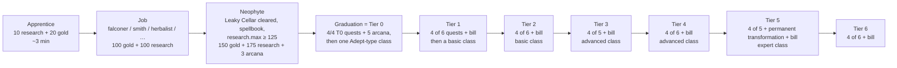

# 04: Progression spine

How a wizard advances: apprentice → graduation → tiers 0-6, with classes as keys and tier-ups as bills that also close doors. Numbers from the testing build (`data-tables.md → Tier unlockers / Tier quests / Classes`); rules in the author's words in `glossary-verbatim.md → progression`. The earlier study (`../arcanum-mechanics-2026-10-18/MECHANICS-STUDY.md §3–5`) covers the pinned-source version; differences are called out.

## The ladder

Every step after Apprentice is the same two-part shape: **an unlocker quest** (N-of-M pointers + a bill) **then a class choice** (free or priced, requirement-gated, exclusive within the tier).

## Tier unlockers (testing build)

| Unlocker | Need | Bill | Fame |
|---|---|---|---|
| Neophyte | Leaky Cellar cleared, own a spellbook, research.max ≥ 125 | 150 gold, 175 research, 3 arcana | +10 exp |
| T0 Graduand Magus | all 4 T0 quests | 5 arcana | 1 |
| T1 Mana Proficiency | 4 of 6 T1 quests | 250 research, 5 codices, 300 gold, 2 gems | 2 |
| T2 Arcane Expertise | 4 of 6 | 850 research, 1 tome, 1000 gold, 5 gems | 3 |
| T3 Preeminent Magus | 4 of 5 | 100 scrolls, 10 codices, 5 tomes, 2500 gold, 10 gems | 4 |
| T4 Esoteric Occultist | 4 of 6 | 250 scrolls, 65 codices, 15 tomes, 5000 gold, 25 gems | 5 |
| T5 Magic Immemorial | 4 of 5 **and a permanent transformation** | 25 tomes, 20 runestones, 8000 gold, 35 gems | 6 |
| T6 Eternal Transcendence | 4 of 6 | 15 tomes, 35 runestones, 10000 gold, 50 gems | 7 |

The bill is always in the **shared slow currencies** (gold, research, books, gems), never in a line's exclusive resource. The unlocker `lock`s its own quest tag so the remaining quests vanish once bought.

### The quests are pointers into other systems

| Tier | Quests (need) |
|---|---|
| T0 | Night Owl (buy Aided Thoughts), Equestrian (buy a steed), Erudition (Library Haul ×4), Spellcaster (memorize a spell list) |
| T1 | Root Out Banditry (clear Under Den), Well-Armed (equip a crafted non-training weapon), Uncover the Crypt (clear Ruined Crypt), Home Sweet Home (leave the Inn), Enchanted Scrollery (Scroll Loom via Weaving), Energy Spectrum (unlock all 9 mana types via source upgrades) |
| T2 | Prismatic Rift (clear Elemental Rift), Thaumaturgy (Enchanting + one of each of 9 gem types), Vesparia's Gilded Age (Reedburgh Markets; needs City Pass via City Navigation), Alignment Bias (pick a T1 morality), Bubbling Concoctions (brew a potion), Mercantile Ventures (Shopkeeping; 1000 gold) |
| T3 | Ghost Writer (12 Unseen Scribes), Mountain Trekking (Mt Gorborung), Tattered Cobwebs (Skittering Caverns), Fazbit's Magnum Opus (Fazbit's shop locale), Gematria (enchant your Personal Study) |
| T4 | Bibliophile (Library furniture), Timeline Bifurcation (Timesplit with Chronomancy 5), Ruins of Reverence (Seredite Temple), Echo of the Ages (Hall of Ages), Runic Labourers (hire a runecrafter), Spell Construction (learn Spellcraft) |
| T5 | Den of Pleasure (Desilla's Grotto), Disaster's Emissaries (Elemental Plane), Aerated Abode (3rd stamina upgrade), Realm Splitter (the Gate), Endless Stamina (Vivification) |
| T6 | Wish Upon a Star (store 5 star shards), Ashen Glory (Charred Keep), Dunes of Orrem, Wizard Association (the Hall), Stare Back (Abyss Gazing), Pocket Dimension |

Each tier's set mixes **combat**, **exploration**, **a home/furniture act**, **a skill/upgrade purchase**, and **a build system** (crafting, potions, enchanting, spellcraft, automation). None is a bespoke scene. Because 4 of 5-6 suffice, every tier lets a build skip the one quest that does not fit it (a pacifist skips the dungeon; a nomad skips the furniture).

### Tier-up itself grants and removes

The tier record (`t_4`) carries `mod: {lore.max +4, crafting.max +2, arcanebody.max +1, occultendure.max +1, crystalmind.max +1, sublore.max +10}` and `disable: ["buyscroll"]`. Earlier tiers: `t_0` locks the Musty Library, `t_1` locks Prestidigitation. `gloss_tiers`: "Increasing your tier will grant some notoriety and also unlock skills or upgrades independent of your class choice." Growing up removes the previous stage's tools (Clean Stables, Study, Do Chores, Run Errands, Buy Scroll, the Attic); the wiki's and the data's lock lists agree.

## Classes

80 class records. In the testing build the *rank* tags are **decoupled from the tier number**: `t_basicclass` (8), `t_advancedclass` (9), `t_expertclass` (10) plus legacy `t_tierN` tags on 45 others and `t_job` (4). The owner's save shows the effect: Warden (`t_basicclass`) at T1, Shapechanger (`t_basicclass`) at T2, Druid (`t_advancedclass`) at T3, Protean (`t_advancedclass`) at T4. A basic-rank class is available at T1 *or* T2; the tier counter is advanced by the unlocker quest, not by the class rank.

| Class (save path) | Tags | Require | Cost | mod |
|---|---|---|---|---|
| apprentice | — | research | 10 research, 20 gold | — (opens Home, Skills, Glossary, quests) |
| falconer (job) | t_job | animals | 100 gold, 100 research | gold.rate +0.1, lore.max +2, animals.max +1, naturelore.max +1 |
| adept (T0) | t_tier0 | t0unlocker, research.max ≥ 100, lore ≥ 4 | 225 research, 200 gold | mysticism/lore/history/languages.max +1, mana.max +5, mana.rate +0.1 |
| warden | basic, nature | naturelore ≥ 8 | free | research.max +5, naturelore.max +3, animals.max +3, potions.max +1 |
| shapechanger | basic, shapeshift | anatomy ≥ 3, alchemy ≥ 3 | free | anatomy.max +1, stamina/vigor.max +10%, `anatomy.mod.shiftdmg +1` |
| druid | advanced, nature | warden owned, naturelore ≥ 15 | free | naturelore.max +3, animals.max +2, herbalism.max +2, potions.max +1 |
| protean | advanced, shapeshift | anatomy ≥ 10, any shapeshift class | free | stretchself.max +2, alchemy.max +1, anatomy.max +2, `alchemy.mod.hp.max +0.5`, `anatomy.mod.stamina.max +0.5`, `anatomy.mod.vigor.max +0.5` |

Observations that hold across the 80:

- **Classes are keys, not stat blocks.** The mod is almost always skill-cap raises (+1…+3) and `X.mod.Y` patches. Nothing a class grants is a number the player watches directly; it is permission to train further and a multiplier on existing training.
- **Line membership is a tag that counts.** `t_natureclass`, `t_shapeshiftclass`, `t_swordclass` (9 classes), `t_manaclass` (8), `t_shadowclass` (7), `t_knowledgeclass` (6)… Later classes require `g.t_shapeshiftclass>=1` or `(g.t_bloodclass+g.tier4)>=2`, so *how many classes of this line you have taken* is itself a gate. "Three from one line" is the wiki's advice because line-count gates and Supremancy/Transcendence education tiers need it.
- **Named predecessors**: druid needs `warden>0`; primarch needs `highpriest>0`.
- **Most classes are free in the testing build** (51 of 80 have a cost; the specialist ones charge in their own gems: primarch 60 lightgem + 40 spiritgem + 15 lightrune + 10 spiritrune). The *tier bill* is where generic money goes.
- **Same tier, mutual exclusion**: `gloss_classes`: "selecting a class will cause all other classes at the same tier to become unavailable, including any classes you might have unlocked later." Visible in the save: 38 class records are revealed (`locked:false`) but only 7 owned; the rest were alternatives at tiers already spent.
- **Secret classes** (`secret: true`, 4): hidden until the triggering event: Red Adept via "The Commoner's Limit" event, Mystic Savant via never studying.

### Graduation: the first identity choice

`gloss_graduation`: common requirement = Aided Thoughts + research.max 100 + Mage Lore 4; options Adept (pay tuition), Dark Adept (slay master → Vile + a body), Blue Adept (200 virtue), Red Adept (secret: clear Treffil Woods Edges without Bind Spellbook), Mystic Savant (never Study). The first irreversible choice ("Studious Master") appears at minute ~3 and the first *hidden* consequence (Study locks Savant) is active from the first scroll.

## Morality is a parallel ladder

`gloss_evil/virtue/neutral` (verbatim in `glossary-verbatim.md`):

| Good | Evil | Neutral |
|---|---|---|
| Decent (virtue 90, evil < 200) | Immoral (evil 5) | Vow of Neutrality (be symmetrically both or neither at each rung; graduated) |
| Respectable (375, evil < 100) | Wicked (250) | Balanced (T1; Wicked + Respectable; 350/350) |
| Virtuous (750, evil < 50; T0) | Vile (500 or slay master; T0) | In Equilibrium (T3; Vile + Virtuous; 750/750) → specialise Spirit or Nature at T4 |
| Scrupulous (1500, no evil; T1) | Sinister (1000; T1) | |
| Incorruptible (3000; T3) | Irredeemable (2000; T3) | |
| Benevolent (T4; never Wicked) | Malevolence (T4; never Respectable) | |

Rungs are quest records in the Main tab's "Morality Options" group (A Virtuous Path / A Vile Path / Vow of Neutrality in the save); the automatic ones fire when thresholds are met. Virtue is earned by Do Chores (+0.3, until rep 500 when it turns to −0.3), Tend Animals, Treat Ailments; evil by Arcane Thievery, Murder. Morality gates classes (necromancer lines need `evil2`), tasks ("with high enough evil you will be prevented from performing Good Acts"), spells (strongest heals / drains), and locales (Rithel requires `evil2<=0`). The save: virtue 49.7, evil −3, alignment `neutral`: a T4 wizard who never engaged morality, which is itself a legal path (T2's morality quest is skippable).

## Wizard level: the fourth axis

`gloss_levels`: experience from kills and encounters; each level +1 spell-list level, +1 stamina, +1 vigor, +2 life; +1 minion level per 5, +1 speed per 3. The save is level 28 with 1043/1257 exp. Level is independent of skills and tiers; it is the combat-side progression and the spell-list budget.

## Pacing evidence

- Apprentice at ~3 minutes; first stage (Neophyte → T0) under an hour (`MECHANICS-STUDY §9`, testing build autoplay).
- The owner's save reached T4 with 44 skills bought, 218 upgrade purchases, 17 dungeons and 13 locales cleared, 21 furniture types, and 1 of 5 T5 quests done. Stored time 8,385 s banked of a 16,200 s cap. See `11-midgame-snapshot-wizrobe.md`.
- Tier bills escalate ~3× per tier in gold (300 → 1000 → 2500 → 5000 → 8000 → 10000) while gold caps are raised by storage furniture/mounts in the same order of magnitude (gold.max 6,796 at T4).

## What the spine teaches

1. Separate **the bill** (shared currencies, escalating) from **the key** (requirements in a line's own skills, mostly free).
2. Make the quest list **point into systems that already exist**, and make it **N-of-M** so each build skips one.
3. **Tier-up removes tools** and **adds caps** on its own, so advancement is felt even before the class is chosen.
4. Classes **count** (line tags as integers) so depth in one line is rewarded without authoring per-class content.
5. Keep **morality, level, tier and skills as four independent ladders** that gate each other at a few named points.
