# 05: Skills and education

Skills are the central currency of permission: `gloss_skills`: "Skills are the principal requirement for most unlocks in Arcanum." 69 records in the testing build (`data-tables.md → Skills`); the graph shapes are in `../arcanum-mechanics-2026-10-18/MECHANICS-STUDY.md §1–1b` (pinned source, 52 records then). This page adds the testing-build view, the training loop as the player sees it, and the education ladder.

## Lifecycle of one skill

```mermaid
stateDiagram-v2
  [*] --> Hidden: require false
  Hidden --> Visible: require true (e.g. g.herbalism>=3 && g.lore>=3)
  Visible --> Buyable: need true (source furniture / tag)
  Buyable --> Owned: pay buy (arcana 5–150 or research 10–2500)
  Owned --> Training: Train (takes an action slot; run stamina 0.2–0.7/s, some research/mana/element)
  Training --> Owned: Stop / slot displaced
  Training --> LevelUp: exp reaches threshold (overflow lost)
  LevelUp --> Training: level < max
  LevelUp --> Capped: level == max
  Capped --> Training: something raises max (class, upgrade, education, site of learning, furniture, home, tier)
```

- **Entry** is cheap and usually gated by a **source arrangement**: `herbalism: need plantsource`, `crafting: need workspace`, `weaving: need weavesource`, `divination: need spiritsource`, every elemental `*lore: need g.lore>=3 && g.<element>source>0`, `chronomancy: need timesource`, `runelore: need dwarfbook`, weapon skills `need armssource`. Sources are tags carried by furniture (20 kinds across 128 furniture records: shadowsource 9, firesource 6, spiritsource 5, lightsource 4 …) and by homes (`camp: starsource`, `cavern: earthsource`, `lighthouse: watersource,lightsource`, `home_emporium` carries fourteen). So the Home tab is the place where new skills become *startable*.
- **Runway**: default `max` 5. 15 skills set their own base max (mostly 1 for mastery skills); those exist only to be raised by a line's content.
- **Per-level payout** is the skill's own `mod`: Nature Studies `research.max +5, nature.max +1, nature.rate +0.01` per level; after education upgrades the tooltip shows `Max Research 5, Max Nature 1.5, Nature Rate 0.022, Nature Potency 0.8, Max Nature Runes 0.25, Resist Nature 1` per level.
- **Exp threshold** rises with level and with the skill's `level` field (a difficulty rating: 46 skills carry it; 5 for crafts, 10 for enchanting/spellcraft/charms/runelore, 15 for the second-tier lores and chronomancy, higher for void/astral). Observed thresholds in the save: L5→128, L6→151, L7→180, L8→92 (low-difficulty), L11→361, L14→254, L15→303, L18→515, L19→615, L20→735, L21→880, L25→1803 (Nature Studies), L7 Chronomancy→1052 (difficulty 15). Not a single curve: difficulty scales it.
- **Rate**: `rate: 1` default exp/s, multiplied by rate mods (`chronomancy.rate +1` from an education upgrade doubles it), plus **Focus** (mana → exp on the top slot, ≈ +40%; wiki: 0.02 mana for 0.02 progress).
- **Overflow is lost on level-up** and exp only accrues while the skill holds a slot, so "which skill is in the slot" is the main decision of the mid-game, and the Goal/Hobby system exists largely to manage it.

## The skill web at a glance

| Shape | Testing-build examples |
|---|---|
| Trunk | Mage Lore (`lore`): gates the elemental lores at 3, Anatomy/Spirit Communion at 6, Conjuration 7, Mysticism 8, Charms 10, Enchanting 11, Spellcraft 15 (and T3), Arcane Mastery 20, Magiphysics 25; "final unlock at level 35" (`gloss_skills`). Tier-ups raise its cap directly (`t_4: lore.max +4`). |
| Entry schools (9 "prismatic" manas) | Aquamancy, Aeromancy, Pyromancy, Geomancy, Lumenology, Umbramancy, Spirit Communion, Nature Studies, (Mage Lore for mana). T1 quest "Energy Spectrum" = own all nine. Each raises its element's max and rate per level. |
| Bridges | Nature Studies = Herbalism 3 + Lore 3; Potions = Alchemy + Crafting; Conjuration = Lore 7 + Divination 3; Magic Beasts = Animals + Nature; Puppetry = Crafting 8 + Spirit Communion 4; Vivification = Anatomy + Spirit Communion; Travel = Languages + World Lore ≥ 12 (sum). |
| Masteries (`max: 1`, school-tagged) | `airlore2`, `earthlore2`, `firelore2`, `lightlore2`, `manalore2`, `spiritlore2` (need `summonsource`) … require the entry school ≥ 10 **and** the "master of" class tag; drain the element they master. |
| Cross-feeders | Languages → Lore rate; Weaving → Crafting; Runic Lore → Lore/Languages max; History → Travel; Magic Beasts → Animals rate. |
| Action-unlocked | Trickery = 10 Prestidigitation casts **or** T1 **or** a Hall item; Concentration = locales completed; Rejuvenation = healing casts; City Navigation (Reedburgh module); Shopkeeping (1000 gold). |
| Noncombat defence | Concentration (+1 max to each stress per level), Composure (−0.1/s to all five per level). |

Costs: `buy` arcana from 5 (early elements) to 150 (Astral Communion); seven are research-bought (Languages 10, Crafting/Mage Lore/Animal Handling 20, Herbalism 25, Enchanting 300, Runic Lore 2500). Running drains are stamina 0.2-0.7/s; eight also drain research, four mana, and the element schools drain their element.

## Education upgrades: the depth ladder

`gloss_education`: unlocked at **skill level 3 with max ≥ 5**, then every 5 levels; each tier requires the previous. Names: **Competence → Expertise → Mastery → Supremancy → Transcendence** (32 / 25 / 21 / 24 / 10 records). Each is an `X.mod.Y` patch that raises what every level of the skill pays, often also `+1 max` and `+rate`:

| Upgrade | require | cost | mod |
|---|---|---|---|
| Timely Independence (Chronomancy, 3rd rung) | chronomancy ≥ 3 && previous rung | 3 tempus, 250 research | chronomancy.max +1, .rate +1, `.mod.tempus.rate +0.006`, `.mod.offlinetime.max +1800`, `.mod.dist +3%` |
| Umbramancy: Transcendence | shadowlore ≥ 23 && shadowlore.max ≥ 25 && previous | 1 tome, 2500 research | shadowlore.rate +0.7, `.mod.shadow.max +0.5`, `.mod.shadow.rate +0.003`, `.mod.shadowrune.max +0.25`, `.mod.shadowdmg +0.7` |
| Geomancy: Transcendence | earthlore ≥ 23 && max ≥ 25 | 1 tome, 2500 research | …`.mod.earthdmg +0.7`, `.mod.hammerdmg +1` |

"Supremancy and Transcendence are generally only accessible to classlines specializing in the relevant skill"; the `max ≥ 25` requirement can only be met with class raises. **Crafting** is the exception: its education rungs (Arms of Iron / Quicksteel / Adamant / Masterwork) unlock equipment tiers for everyone. The Player tab's upgrade list for the save shows the ladder in use: Nature Studies Competence/Expertise/Mastery/**Supremancy**, Animals and Anatomy and Astronomy to Mastery, most others to Competence or Expertise.

## Arcana: the skill currency

`arcana.max` base 0; raised per level by Mage Lore (+1), by tomes held (`tomes.mod.arcana.rate`), by the Arcane Archive's `Tomes ➢ Max Arcana 0.05`, by Mysticism; generated passively (`arcana.rate 0.0001` in the save) and in lumps for clearing locales (Rithel pays `arcana 1.5`). It is spent on skills (and some upgrades: Aided Thoughts 2, Timesplit 10). The save sits at 100/100: arcana is a **cap-bound** currency; the player buys a skill as soon as it is affordable, which is the glossary's advice ("there is no advantage in delaying or skipping any of them").

## How it reads on screen

Skills tab: two columns of cards, `Level 14/14.0` (the `.0` because caps are fractional: Weaving adds `crafting.max +0.1` per level, so a cap can read `21.0` or `18.2`), Train/Stop, exp bar, `Exp: 248 / 254`. "Hide Maxed" tidies the capped ones. The running pane shows `Observing Nature 70% (25/26)`: percent to next level and level/cap. Hover gives the per-level mod list and the exp/s rate (`7.2/s`).

## Rules this implies

1. Entry = cheap + a home arrangement; runway = 5 levels each paying a small passive bonus; wall = moved only from outside. (Unchanged from the earlier study.)
2. A skill's **difficulty** (`level`) scales its exp curve; late skills take longer per level without needing bigger numbers elsewhere.
3. **Education rungs** turn "+1 cap" into "+1 cap and every level now also pays X"; the per-level payout grows with investment, so returning to an old skill stays worthwhile.
4. Training occupies a slot and loses overflow: slot allocation, not clicking, is the mid-game decision; priority tools are the reward for mastering it.
5. The skill currency should be **cap-bound** so purchases are immediate and the cap raisers (trunk skill, books) are the real pacing.
