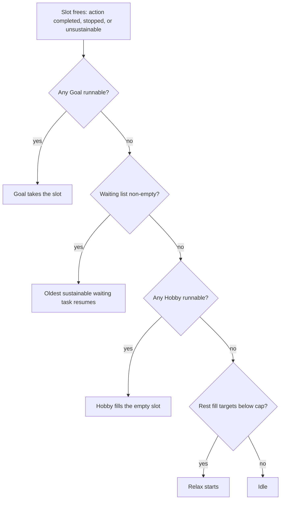

# 10: Automation and time

Control over *what runs* and *when time passes* is a reward track in Arcanum, handed out across the whole game. Sources: `gloss_tasks`, `gloss_waiting`, `gloss_priority`, `gloss_focus`, Hall glossary (`glossary-verbatim.md`, hall entries quoted in `03`), `data-tables.md → Action-slot sources / Goal-Hobby sources`, `wiki-notes.md §6, §8, §9`, `../arcanum-study-2026-10-16/STUDY.md` (120 ms tick, stored-time simulation).

## The control ladder

| Stage | Control gained | How |
|---|---|---|
| Minute 0 | One action slot; Relax auto-fills it when idle and something is below cap (`fill`). Hold **Enter** to repeat an instant task at 20/s. | base |
| Apprentice | Per-section ⚙ to **hide** tasks (misclick protection); ★ pins. | UI |
| Neophyte (research.max ≥ 90) | **Aided Thoughts**: +1 action slot (150 research, 2 arcana). Also the T0 quest "Night Owl". | upgrade |
| Mage Lore 6 / 7 | **Dedicated Goal** (+1 Goal), **Idle Hobbies** (+1 Hobby). | upgrades |
| Any skill owned | **Focus** (mana → exp on top skill) and **Auto Focus** toggle. | runner |
| T1 / T2 / T5 | **Maniacal Goals** (+1 Goal), **Expanded Interests** (+1 Hobby), **Never-idle** (+1 Hobby). | upgrades |
| Chronomancy 5 (T3+) | **Timesplit**: +1 slot (10 arcana, 5 tempus). T4 quest "Timeline Bifurcation". | upgrade |
| Chronomancy education | `offlinetime.max +1800` per level (Timely Independence rung); the bank grows with the skill. | `X.mod.Y` |
| T5 | **Time Spiral** (needs 3 slots already) **or** **Automata Agents** (Automata Sculpting 10): +1 slot, mutually exclusive. | upgrades |
| Hall | **Time Fork** (new wizards start with Timesplit), **Time Knife** (a second Timesplit), **Time Skewer** (new wizards start with 3600 s banked), **Dream Chamber** (stronger perpetual rest). | prestige |

The save (T4): `runner.actives: ["rest","naturelore","craftgem"]`: three slots (1 base + Aided Thoughts + Timesplit), `waiting: ["spiritanatomy"]`, `goals/hobbies.max 0` (never bought), Auto Focus available. Stored time cap 16,200 s = 3,600 base + 7 Chronomancy levels × 1,800.

## Priority model (not a queue)

- **Waiting** = displaced slot tasks; capacity slots + 5; FIFO eviction. The Activities popup (`≡`) shows them and lets the player assign G/H to waiting entries.
- **Goal** re-asserts on *any* completion (high priority); **Hobby** only fills *empty* slots (low priority). One flag per task.
- `fill` makes production tasks self-stopping, which is what keeps the waiting list short.
- "Stop All" is the panic button; individual ✕ per row.

## Time

- **Tick**: 120 ms simulation; UI shows smoothed bars (setting "Smooth bars").
- **Stored time** (`offlinetime`, group Basic): accrues 1 s per real second away, up to `max` (3600 base). On return the game does **not** auto-apply it; it is a resource. **Fast-forward** (top bar) spends it by running the simulation faster. The wiki adds: an inactive Hall wizard also accrues it; the Hall can seed 3600 s.
- **Tempus** (Fundamental Energies bar, Chronomancy) is the *in-game* time mana: generated per Chronomancy level, spent on Timesplit (5), education rungs (3), and time spells (Borrow Time, Time Walk `speed +1.5`).
- **Instability** resource: `tempus.rate −0.2%` per unit, a debuff for overusing time magic.
- Clear time of encounters is fixed (5-25 s), the one place where wall-clock pacing is authored directly.

## Save, load, and the Hall

- Browser storage with auto-save; manual Save/Load/Get Save/[Load Save]; JSON export of the sparse delta (`03`).
- **Wizard's Hall** (T6 quest "Wizard Association"; upgrade ~15,000 gold / 35,000 research / 50 tomes per wiki): a non-resetting prestige layer. 3 wizard slots → 9. **Prestige** = all notoriety ever earned (`evt_hall: hallPoints = g.fame`), kept per hall, spent on 19 hall upgrades that apply to every wizard: Classrooms (`study.effect.research +0.15`), Magic Stables (`chores.result.gold +1`), Arcana Collectors (`arcana.rate 0.01+5%`), Spellspire (`spellcraft.max +1`), Time Fork/Knife/Skewer, Dream Chamber, Star Chamber (`fame.rate 3.4e-5`, pays back in ~80 h), Enhanced Laboratories, Expanded Halls, Great Wing. Each prestige point also gives +0.1% skill rate and +0.1% stress capacity (wiki). A separate "Hall Save" button appears once owned.

The Hall reuses the mod-patching idiom (`03`) to make *new* runs faster at the *beginning* (chores, study, stables): a prestige layer that touches minute 1 rather than the endgame.

## Rules this implies

1. Start with one slot and an auto-filling rest; add slots as rare, named milestones (4 across the whole game), not as a shop.
2. Model automation as **priority flags on existing tasks** (Goal/Hobby) plus a bounded waiting list; unlock each flag separately.
3. Keep the offline bank a **resource with a cap** that the player spends deliberately (fast-forward) and can grow (skill education, prestige); never silently apply away time.
4. Give time magic its own mana (tempus) with its own debuff (instability) so acceleration is a build, not a setting.
5. Prestige should patch the opening (`chores.result.gold +1`), so replays start faster without resetting anything.
