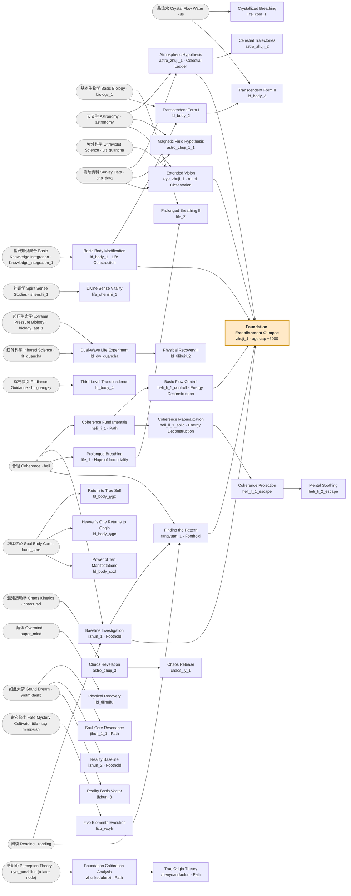

# 02: Cultivation and progression

How *Hundred Days* lays a cultivation framing over the Arcanum progression spine: what the opening looks like, what the 修炼 Cultivation tab actually is, what is left of tiers and classes, where the community's "six major stages" live in the data, and what the game does with lifespan — the one axis Arcanum does not have.

*Hundred Days* is the author's own English title for **筑基 Zhùjī** ("Foundation Establishment"); the upstream `README.md` states plainly that 筑基 "是由放置游戏-Arcanum重制而成" — it is a remake of the idle game Arcanum, still in development. Almost every engine class, field name and UI idiom in this page is Arcanum's; what differs is content, and the differences are the point.

## Sources and how numbers are tagged

| Tag | Meaning |
|---|---|
| `[P0.3.9c data]` | The shipped JSON, 67 files in `data/*.json`. Chinese names read from the upstream `master` branch (HEAD `91ba763`); English names from the `english` translation branch (HEAD `9e1e0d3`), whose records align index-for-index with `master`'s. Both bundles report `P0.3.9c`. |
| `[P0.3.9c engine]` | Read out of the webpack bundle `js/hundred_days.js`, which reports `VERSION(){return "P0.3.9c"; }`. |
| `[P0.3.9c run]` | Measured by driving the real game headlessly (Chromium via Playwright, local static server, `window.game` stepped one simulated second per call by backdating `game.lastUpdate`). Run on 2026-10-21. |
| `[wiki tips]` | The community wiki's hand-written strategy page 筑基小贴士 ("Foundation tips", credited to 群友@DG) and its `FAQ` page. **Player testimony, not data**; every claim from it is cross-checked below. |
| `[INFERENCE]` | My reading, not stated anywhere. |

Term alignment follows the translation branch's `docs/translation/GLOSSARY.md`, which is the binding English for this game's vocabulary. Where the brief and the glossary disagree I use the glossary: 立足 is **Foothold**, not "Footing"; 黄泉 is **Netherworld**, not "Yellow Springs"; 合理 is **Coherence**, not "reason".

One collision to watch, because it matters in §1: the translation renders **both** 体力 (`tili`, the resource every click spends) and 精力 (`stamina`, the player stat that does not come back) as "Stamina". This page follows the wording the translators themselves used in 歇息 Rest's description — "restores stamina but not vigor" — and writes **体力 Stamina (`tili`)** and **精力 Vigor (`stamina`)**.

Record counts `[P0.3.9c data]`: `xiulian.json` 193, `classes.json` 19, `skills.json` 89, `player.json` 55, `resources.json` 310, `tasks.json` 256, `upgrades.json` 251, `techo.json` 30, `sections.json` 21, `hall.json` 1 module.

---

## 1. The opening

### 1.1 What exists at a cold boot

Every record defaults to `locked = true` in the `GData` constructor, and the tech tree only ever re-tests a record when something it names in `require`/`need` changes — a record with neither is never swept and never appears `[P0.3.9c engine]`. So the start screen is tiny.

Driving a fresh profile and stepping 30 simulated seconds with no clicks `[P0.3.9c run]`:

| Type | Unlocked at boot |
|---|---|
| 任务 tasks | 3: 按TAB打开指引页 Press TAB to Open Guide (`helper_1`), 扫地 Sweep Floors (`clean`), 歇息 Rest (`rest`) |
| 升级 upgrades | 0 |
| 技能 skills | 0 |
| 修炼 xiulian | 0 |
| 职业 classes | 0 |
| 版块 sections | 3 of 21: 主菜单 Main (`sect_main`), 玩家 Character (`sect_player`), 成就 Achievements (`sect_achievement`) |

The 21 sections and their gates `[P0.3.9c data]`:

| id | 中文 | English | `require` |
|---|---|---|---|
| `sect_main` | 主菜单 | Main | — |
| `sect_player` | 玩家 | Character | — |
| `sect_achievement` | 成就 | Achievements | `g.hp>=1` (always true) |
| `sect_skills` | 技能 | Skills | `g.ganwu>0` |
| `sect_xiulian` | 修炼 | Cultivation | `g.heli` |
| `sect_spells` | 法术 | Spells | `g.heli` |
| `sect_market` | 交易 | Market | `g.market_un>0` |
| `sect_equip` | 装备 | Equipment | `g.market_un>0` |
| `sect_raid` | 探险 | Adventure | `g.small_map>=1` |
| `sect_home` | 居所 | Dwelling | `g.home_un>=1` |
| `sect_techo` | 研究 | Research | `g.xl_lj_konwledege_1>=1` |
| `sect_humanr` | 人力 | Workforce | `g.rlgl>=1` |
| `sect_mode` | 模型 | Workshop | `g.shengchanlun>=1` |
| `sect_potions` | 元素 | Elemental | `g.yaolixue>=1` |
| `sect_enchant` | 铭刻 | Enchanting | `g.mwxue>=1` |
| `sect_conquer` | 征服 | Conquest | `g.shenshi_3>=3` |
| `sect_minions` | 随从 | Minions | `g.shenshi_4>=999` (unreachable) |
| `sect_svehicle` | 构造 | Construction | `locked: true`, no `require` (dead) |
| `sect_scraft`, `sect_bestiary`, `sect_craft` | — | untranslated Arcanum leftovers | `spellcraft` / `g.bestiary>0\|\|g.lore>=11` / — |

This is Arcanum's rule 8 intact: *a new system arrives as a whole tab gated by one requirement.* Three of the 21 are Arcanum carry-over that never got Chinese names, and two (`sect_minions`, `sect_svehicle`) are gated shut.

### 1.2 One gate does not hold

`require: "g.heli"` is compiled to `new Function("g","i","s","return g.heli")`, and `g` is `state.items`, a map of record objects — so the expression returns an **object**, which is always truthy, rather than Coherence's value `[P0.3.9c engine]`. The sweep only reaches these records once something else changes, but when it does they pass unconditionally. Measured `[P0.3.9c run]`: in the route of §1.3 the 修炼 Cultivation and 法术 Spells tabs both open at step C (in-game day 45.9), together with the two `g.heli` cultivation nodes 初步认识合理之理 Coherence Fundamentals (`heli_li_1`) and 悠久呼吸 Prolonged Breathing (`life_1`) — while 合理 Coherence itself is still `locked`, value 0, cap 0. Nothing about step C causes it: a second run under a different (deliberately worse) click policy opened the same four at day 36.5 with coin stuck at 4. Whichever sweep reaches them first is the one that passes them.

So the Cultivation tab is on screen about a minute in, showing two nodes the player cannot buy for another ten. The real gate is the price: `heli_li_1` costs 3 Coherence, and Coherence has a cap of 0 until a class raises it. Arcanum's rule 2 (*visibility reveals, `need` explains what is missing*) is satisfied by accident and without the explanatory text.

The fix was available in the same engine. A `require` string that is a bare identifier is **not** compiled — `IdTest = /^[A-Za-z_]+\w*$/` keeps it a string, and `unlockTest` then calls `getData(test).fillsRequire()`, which is `locked === false && value > 0` `[P0.3.9c engine]`. The task 专注 Focus writes `require: "heli"` and gates correctly; the two sections write `require: "g.heli"` and do not. Of the 17 sections that carry a `require`, 15 write a comparison; only 修炼 Cultivation and 法术 Spells use the bare `g.` form. `[INFERENCE]` The author meant `g.heli>0`.

### 1.3 The route to the first cultivation node

Played headlessly with a competent-but-not-optimal policy: click the best-paying instant task, buy every revealed cap raiser, rest when out `[P0.3.9c run]`. Clicks are free in this harness and ticks are one simulated second, so the `sim` column is a floor on wall-clock time; the wiki notes you can hold Enter for about 20 clicks/s `[wiki tips]`, which makes the 233 clicks here worth roughly 12–45 s of real time. "Day" is the `time` resource — the game's age counter.

| # | Step (record) | Cost | What it pays | What it opens | sim s | day |
|---|---|---|---|---|---|---|
| 0 | cold boot | — | — | 3 tasks, 3 tabs | 0 | 1 |
| 1 | 扫地 Sweep Floors (`clean`) ×34 | 0.5 体力 Stamina + 0.1 精力 Vigor each | 0.2 coin, **+0.5 day** each | 零钱小包; the three tier-0 jobs | 9 | 17.8 |
| 2 | 零钱小包 Small Coin Pouch (`smallbag`) | 5 coin | coin cap 10 → 30 | — | 10 | 18.9 |
| 3 | Sweep Floors ×62 | as above | coin to 10.2 | 阅读 Reading, 贸易 Trade (`market_un`), 附近地图 Nearby Map (`small_map`), 寻找帮工 Recruit Helper, 深度休息 Deep Rest — **and the Cultivation + Spells tabs** (§1.2) | 22 | 45.9 |
| 4 | 劳工 Laborer (`pl_apprentice`, class) | 10 coin | Stamina cap +5, **+3 days** | 运货 Haul Cargo via event 新工作 New Job (`g.time>5 && g.pl_apprentice>0`) | 24 | 62.3 |
| 5 | Sweep Floors / Haul Cargo ×124 | — | coin to 27.3 | 游历 Wander, 扩展钱袋, 房屋 Housing | 32 | 133.6 |
| 6 | 游历 Wander (`youli`) ×13 | 0.7 Stamina + 0.15 Vigor | 0.1 coin, **0.05 感悟 Enlightenment**, +2 days | **first Enlightenment → 技能 Skills tab**; 购买书籍 Buy Books | 34 | 154 |
| 7 | 阅读 Reading (`reading`, skill) | 10 coin | — | — | 35 | 169.7 |
| 8 | train Reading to level 1 | 0.5 Vigor/s while running; **+0.5 day/s** | Enlightenment cap 3 → 4 and rate +0.02/s | 购买稿纸 Buy Draft Paper, 写下经验 Record Experience, 领会感悟, 城镇学校 Town School | 375 | 323.4 |
| 9 | 领会感悟 Enlightenment Comprehension (`ganwu1`) | 1 Enlightenment | — | class 接触道理 | 404 | 333.9 |
| 10 | 接触道理 Touch the Principle (`touch_daoli`, class) | 4 Enlightenment | **Coherence cap 0 → 3**, spell-list +1, unlocks 合理 | 专注 Focus, 跑步健身 Running Fitness, 风行 Wind Movement | 555 | 333.9 |
| 11 | 深度休息 Deep Rest (`depp_rest`) ~200 s | **1.7 day/s** | Vigor +1/s, Stamina +10/s, **all four 修炼 energies +0.8/s** → Coherence 3/3 | — | 755 | 361.4 |
| 12 | 购买书籍 ×3, 购买稿纸 ×16, 写下经验 ×2 | 2 coin/book; 1 coin/paper; 8 paper + 3 Enlightenment per record (10 s each) | 1 书籍 Books, 2 经验记录 Experience Records | 谋杀 Murder, class 学生 Student | 883 | 1162.9 |
| 13 | **初步认识合理之理 Coherence Fundamentals (`heli_li_1`)** | buy 1 book; cost 1 Enlightenment + 3 Coherence + 1 book + 2 experience records | +13 days, Coherence rate +0.01, twin `xiulian_heli_1` | 初步流控制 Basic Flow Control, 合理实质化 Coherence Materialization | 885 | **1193.3** |

**The first cultivation node costs 1,193 days — 3.3 years of a 60-year life — and about 800 of those days are Deep Rest.** 精力 Vigor (`stamina`, 10 base) is spent by every click and by training, and *only* Deep Rest restores it, at 1.7 days of lifespan per second. 体力 Stamina (`tili`) comes back from ordinary 歇息 Rest at 0.1 day/s. That asymmetry is the opening's actual pacing mechanism, and nothing in the UI names it.

Three further shapes the route exposes, all of them readable in the records `[P0.3.9c data]`:

- **The first tool is removed, as in Arcanum.** 寻找帮工 Recruit Helper (`find_people1`, 14 coin, 10 s) pays `money.rate +0.1` and carries `disable: ["clean"]` — hiring a worker ends Sweep Floors. The event 新的锻炼方式 New Training Method likewise disables 运货 Haul Cargo once you own 初等身体改造 Basic Body Modification.
- **感悟 Enlightenment is the trunk currency and it starts locked.** No record sets it; the only way to turn it on is to be *paid* some, and the only early payer is 游历 Wander at coin > 25. A player who never wanders never sees the Skills tab.
- **The knowledge chain is the real first wall.** 稿纸 Draft Paper and 经验记录 Experience Records both require `g.reading>0`; one Experience Record is 8 paper + 3 Enlightenment over 10 s, and Enlightenment caps at 4 at that point. Cultivation is gated on paperwork.

### 1.4 Compared with Arcanum and with Lowbridge

Arcanum figures from `research/arcanum-reference/04-progression-spine.md` and `wiki-notes.md` §1; Hundred Days from §1.3 above; Lowbridge from `design/DESIGN-PLAN-2026-10-18.md` §C.5 and the validator's measured bounds.

| | Arcanum 0.12.12.9 | Hundred Days P0.3.9c | Lowbridge chapter one (`design/DESIGN-PLAN-2026-10-18.md` §C) |
|---|---|---|---|
| First decision | Buy Scroll → Apprentice, 20 gold + 10 research, "~3 minutes" (`04-progression-spine.md`) | 零钱小包 at coin > 6, ~10 s of clicking; first *irreversible* choice 农夫/商人 Farmer vs Merchant appears in the same breath, with `warn: true` | Cracked Jade Slip at 6 coin on the third herb sort, beat 2 |
| First tab opened by play | Home/Alcove + Skills on Apprentice | Cultivation + Spells open on their own at ~day 46, before they can be used; Skills needs a 游历 Wander click | Lore/Qi Sense families appear with the slip |
| First real system | Skills, gated by a furniture "source" tag | Cultivation, gated by a class purchase (Coherence cap) and a paper supply chain | Practice families, gated by the slip |
| First stage ends | Neophyte → T0, "under an hour" | first cultivation node at ~15 min of attentive play; 筑基窥探 Foundation Glimpse much later | Foundation at 13.0–14.9 min on the direct routes (the figure `AGENTS.md` records from `bun run validate`) |
| Opening currency | gold + research, both cap-bound | coin, 感悟 Enlightenment, **and lifespan**, which is never recovered | coin, herbs, vigor; no lifespan axis |

Arcanum's *wiki* opening guide (`research/arcanum-reference/wiki-notes.md` §1) is a loop — "run available tasks, spend on upgrades/furniture, train newly available skills, repeat" — with no clocked schedule. Hundred Days' opening is the same loop with one extra beat: every click also spends the resource you are trying to extend.

---

## 2. The cultivation graph

### 2.1 Shape

193 records, one tag each, 17 tag groups `[P0.3.9c data]`. Every record has exactly the same field set: `id`, `name`, `desc`, `tags`, `require`, `max`, `cost`, `xiulianresult`; seven add `buy` and one adds `flavor`. **Every one of the 193 carries `max: 2`.**

Taking a node is `game.xiulian(it)`: pay `cost`, apply `xiulianresult`, set `complete = 1`, `amount(1)` `[P0.3.9c engine]`. There is no timer and no slot — a cultivation node is an instant purchase, exactly like an upgrade.

| 中文 | English (glossary) | nodes | of which are entry points | first node |
|---|---|---|---|---|
| 生命构造 | Life Construction | 31 | 22 | `ld_body_1` |
| 能量解构 | Energy Deconstruction | 19 | 11 | `heli_li_1_controll` |
| 元素工程 | Elemental Engineering | 19 | 12 | `chaos_yuansuydong` |
| 路径 | Path | 16 | 5 | `heli_li_1` |
| 永生之望 | Hope of Immortality | 16 | 11 | `life_1` |
| 思维 | Cognition | 14 | 8 | `shifangzhutai` |
| 观测之术 | Art of Observation | 12 | 8 | `eye_zhuji_1` |
| 物体结构 | Material Structure | 11 | 6 | `struct_1` |
| 立足 | Foothold | 8 | 7 | `jizhun_1` |
| 能量物理 | Energy Physics | 8 | 3 | `x_energ_1` |
| 几何 | Geometry | 7 | 7 | `math_jihe_1` |
| 通天阶梯 | Celestial Ladder | 6 | 4 | `astro_zhuji_1` |
| 形态变化 | Phase Transition | 6 | 4 | `change_metal_1` |
| 死亡 | Death | 6 | 3 | `death_1` |
| 多元程式 | Multivariate Calculus | 6 | 4 | `math_fc_1` |
| 信息海 | Sea of Information | 5 | 2 | `x_info_1` |
| 空间系 | Spatial Systems | 3 | 3 | `math_kj_1` |

"Entry point" = the node's `require` names nothing that another cultivation node produces. **120 of 193 (62%) are entry points.** The cultivation "tree" is mostly a flat catalogue keyed on skills, materials and upgrades; only 73 nodes have a cultivation prerequisite at all. 路径 Path (5 of 16 entry) and 能量物理 Energy Physics (3 of 8) are the only groups that behave like chains; 几何 Geometry and 空间系 Spatial Systems are pure catalogue.

### 2.2 The hidden resource twin

The wiki says each cultivation node has a hidden resource twin `[wiki tips]`, and the data mostly agrees `[P0.3.9c data]`:

- 168 of 193 nodes (87%) pay into at least one resource in the 修行 Cultivation group.
- The 修行 group holds 165 resources; 156 of them are produced by exactly one node. All 156 are `hide: true`, `locked: false`, and 156 of the 165 have `max: 1`.
- The 25 nodes with no twin pay only into stats and caps — the 永生之望 lifespan nodes, the 体力恢复 Physical Recovery pair, the three offline-time nodes.
- Nine 修行 resources are *not* produced by a node (`ganwu`, `lg`, `herbal_hide`, the three 命玄/落日 True Soul markers, …) — they are the group's visible currencies.

The twin is what every downstream gate reads: `require: "g.xiulian_ld_body_1>=1"`, never `g.ld_body_1`. Because the twin caps at 1 while the node carries `max: 2`, a node can be bought twice for double payout but the second purchase changes nothing anyone is watching. `[INFERENCE]` `max: 2` is boilerplate, not design.

### 2.3 Prices

`cost` lines per node run from 1 to 23, with the mode at 13 `[P0.3.9c data]`. The twenty most-used currencies inside `xiulian.json` alone:

| # | currency | nodes pricing in it |
|---|---|---|
| 1 | 感悟 Enlightenment (`ganwu`) | 174 |
| 2 | 钱币 Coins (`money`) | 147 |
| 3 | 计算力 Processing Power (`alculation`) | 115 |
| 4 | 超识 Overmind (`super_mind`) | 112 |
| 5 | 零结晶 Zero Crystal (`zero_crystal`) | 109 |
| 6 | 人力 Workforce (`human_power`) | 96 |
| 7 | 晶流水 Crystal Flow Water (`jls`) | 84 |
| 8 | 灵光 Spirit Light (`lg`) | 79 |
| 9 | 经验记录 Experience Records (`exe_paper`) | 75 |
| 10 | 虚灵星图 Void Spirit Star Chart (`star_map_1`) | 71 |
| 11 | 灵血 Spirit Blood (`lxue`) | 69 |
| 12 | 稿纸 Draft Paper (`paper`) | 57 |
| 13 | 冰冻核心 Frozen Core (`cold_core`) | 53 |
| 14 | 合理 Coherence (`heli`) | 52 |
| 15 | 书籍 Books (`books`) | 52 |
| 16 | 粗糙天文记录 Rough Astronomical Record (`star_map`) | 51 |
| 17 | 测绘资料 Survey Data (`snp_data`) | 48 |
| 18 | 污浊核心 Corrupt Core (`dirty_core`) | 43 |
| 19 | 神经材料 Neuro-Material (`sj_met`) | 40 |
| 20 | 活性结晶 Active Crystal (`life_crystal`) | 39 |

感悟 Enlightenment is in 90% of all cultivation prices. It is the game's 研究 research: cap-bound, slow, and raised by almost everything.

**`time` is a price in disguise.** 79 of the 193 nodes list `time: N` in `xiulianresult`, which *adds* N days to the age counter: 13 for `heli_li_1`, 365 for 筑基零重 Foundation Zero Weight, 3,650 (ten years) each for the three 甲乙归真/天一归初/十象之力 body capstones. Several also pay 废热水 Waste Heat Water (`frs`), a pollution resource capped at 10 whose mod is `stamina.rate −0.01, tili.rate −0.01, hp.rate −0.01` — a result field that is really a cost.

### 2.4 The first 34 nodes

The first 34 records of `xiulian.json`, in file order, with every `require` edge they carry `[P0.3.9c data]`. Square nodes are cultivation records; rounded nodes are the gates that sit outside this slice — skills, resources, a tag, and one later cultivation node.



The one node that looks like an Arcanum tier unlocker is **筑基窥探 Foundation Establishment Glimpse (`zhuji_1`)**: six cultivation prerequisites, ANDed, spanning five of the seventeen tag groups, for 70 Enlightenment + 7 Coherence + 5 books + 8 Zero Crystal + 5 Survey Data + 25 paper + 6 Experience Records, paying `heli.max +3` and **`age.max +5000`**. Arcanum would make that 4-of-6 so each build could skip one (rule 12). Hundred Days requires all six.

The ladder above it `[P0.3.9c data]`:

| Node | `require` | Lifespan paid | Time cost |
|---|---|---|---|
| 筑基窥探 Foundation Glimpse (`zhuji_1`) | six nodes, ANDed | `age.max +5000` (13.7 y) | 10 d |
| 筑基零重 Foundation Zero Weight (`zhuji_2`) | `g.chaos_up>=1 && g.xiulian_zhuji_1>=1 && g.zhuji_qianzhi_2>=1` | `+7300` (20 y) | 365 d |
| 筑基一重 Foundation First Weight (`zhuji_2_1`) | `g.jihunyuesheng>=1` | `+37300` (102 y) | 3,650 d |
| 筑基二重 Foundation Second Weight (`crzj_zhujierchong`) | `g.baoyangsizhen>=9` | `+90000` (247 y) | — |

筑基零重 also fires the event 真魂 True Soul (`evt_jihun`), whose text is the clearest statement of the game's thesis: "筑基的境界可以点燃真魂,但同时会导致衰败,足量的真魂可以抑制衰败" — Foundation ignites the True Soul but also causes 衰败 Decay, which enough True Soul suppresses. Decay (`shuaibai`) carries `time.rate +0.6` and −2 to every regeneration: **advancing makes you age faster.**

---

## 3. Tiers and classes

19 class records `[P0.3.9c data]`, tagged `t_tier0` (14) and `t_tier1` (5). Nothing in the game reads `g.t_tier0` or `g.t_tier1`; the only `t_tier*` consumers are six Arcanum leftover events (`tier2`…`tier7`, "Arcane Ascendant", "Dhrunic Pillar") that `lock` tag groups no class carries. **The tier ladder is a label, not a mechanism.** Exclusivity is authored one pair at a time with `disable`.

| id | 中文 | English | tier tag | `require` | Bill | `result` | `disable` |
|---|---|---|---|---|---|---|---|
| `pl_apprentice` | 劳工 | Laborer | t_tier0 | `g.money>5` | 10 coin | +3 d, Stamina cap +5 | — |
| `farmer` | 农夫 | Farmer | t_tier0 | `g.money>5` | 10 coin | +30 d, coin rate +0.01 | `businessman` |
| `businessman` | 商人 | Merchant | t_tier0 | `g.money>5` | 10 coin | +10 d, coin rate +0.01 | `farmer` |
| `touch_daoli` | 接触道理 | Touch the Principle | t_tier0 | `g.reading>=1 && g.ganwu1>=1` | 4 Enlightenment | **Coherence cap +3**, spell-list +1, unlocks 合理 Coherence and the first spell 合理之行 Walk of Rationality (`heli_enchant_1`) | — |
| `student` | 学生 | Student | t_tier0 | `g.books>=1 && g.exe_paper>=1` | 1 book, 1 record | unlocks `jizhun_1`, Enlightenment & Record rate +0.01 | — |
| `xuezhe` | 学者 | Scholar | t_tier0 | `g.fanshe_math>=1` | 9 books, 380 Enl., 50 paper, 20 records, 70 star charts, 20 crystals, 9 Overmind, 21 survey | Zero Crystal rate +0.05, Enl. rate +0.01 | — |
| `zhangguan` | 长官 | Commander | t_tier0 | `g.human_power>=150` | 150 Workforce, 500 coin, +8 lines | Workforce cap +50 | `qsz` |
| `qsz` | 求索者 | Seeker | t_tier0 | `g.alculation>=70` | 70 Processing Power, 150 Workforce, 500 coin, +7 lines | Processing cap +30 | `zhangguan` |
| `yindaozhe` | 引导者 | Guide | t_tier0 | `g.human_power>=1500 && g.zhangguan>=1` | 1500 Workforce, 2000 coin, … | Workforce cap +600 | — |
| `jiaoshou` | 教授 | Professor | t_tier0 | `g.alculation>=2000 && g.qsz>=1` | 2000 Processing, 1000 Workforce, … | Processing cap +400 | — |
| `taguang` | 塔光 | Tower Light | t_tier0 | `g.human_power>=5000 && g.yindaozhe>=1` | 5000 Workforce, 3000 coin, 2000 Processing, … | **Workforce cap +2000** | `caikuang` |
| `caikuang` | 裁光 | Judgment Light | t_tier0 | same as 塔光 | same | Workforce +1000, **True Soul capacity +5**, command cap +15 | `taguang` |
| `manhaiqiushi` | 漫海求识 | Sea of Knowledge | t_tier0 | `g.human_power>=5000 && g.jiaoshou>=1` | 2000 Workforce, 5000 Processing, … | **Processing cap +2500**, command cap +10 | `renwenxuetu` |
| `renwenxuetu` | 人文学徒 | Humanities Apprentice | t_tier0 | same as 漫海求识 | same | Processing +1000, Workforce +1000 | `manhaiqiushi` |
| `wuhuanxuezhe` | 五环学者 | Five Elements Scholar | t_tier1 | `g.xiulian_zhuji_wuhuan_1>=1` | the five 精华 Essences ×25 each, 35 Overmind, 1600 coin, +8 lines | Enl. rate +1, Zero Crystal rate +0.05 | 落日/本源 **and** 谋杀 Murder, 污蔑 Slander, 窃密 Theft, 无光秘术, 无光核心 |
| `benyuanxuezhe` | 本源学者 | Origin Scholar | t_tier1 | `g.xiulian_zhuji_wuhuan_2>=1` | 10 `yjdl`, 10 `gwl`, 35 Overmind, 1600 coin, +8 | **Enl. rate +2**, Zero Crystal rate +0.1 | same list as 五环 |
| `wuguangxuezhe` | 落日学者 | Sunset Scholar | t_tier1 | `g.xiulian_wuguangzhihuan>=1` | 10 Lightless Cores, 30 Corrupt Cores, 20 Spirit Bodies, … | Enl. rate +1, Zero Crystal rate +0.05 | 五环, 本源 only |
| `chugui` | 初归 | First Return | t_tier1 | `g.xiulian_gcwuguan>=5` | 2 `neizaiqianli`, 600 Enl., 70 crystals, 10 Active Crystals, … | Stamina cap +5, Enl. rate +2 | — |
| `guixuan` | 归玄 | Return to Mystery | t_tier1 | `g.xiulian_body_gczf>=3` | 10 `baizhan`, 9 Soul Body Cores, 9 苍蓝, 9 辉光, 1600 coin | Vitality +20, Stamina +5, three rates +2/+2/+3 | — |

### 3.1 The three scholars and the morality fork

The wiki's headline class question is 本源学者 vs 五环学者 vs 落日学者 `[wiki tips]`, and its unlock conditions check out exactly:

| Wiki claim | Data `[P0.3.9c data]` |
|---|---|
| 本源学者 "build 20 obelisks and commit no murder" | `zhuji_benyuan_2` 本源之理 requires `g.obelisk>=20 && g.evilamt<=0`. `obelisk` 方尖碑 is a **tag**, carried by 8 furniture records (灵血/战火/纯白/磁流/炽热/交感/芥子 at `max: 5` each, 飘渺 at 3), so 20 is reachable across types — Arcanum's tag-counting idiom (rule 11) without the `t_` prefix |
| 五环学者 "obtain 源泉灵木, 纯白金石, 阳息烈石, 无垢玉髓, 载德厚土 and commit no murder" | `zhuji_wuhuan` 五环进阶 requires `g.evilamt<=0 && g.yqlm>=1 && g.cbjs>=1 && g.yxls>=1 && g.wgys>=1 && g.zdht>=1`; 五环之理 repeats `g.evilamt<=0`; the class bills 25 of each of the five |
| 落日学者 "无光秘术 to level 2" | `wuguangzhihuan` 无光之环 requires `g.nolight_mishu>=2 && g.evilamt>=0` |

恶 Vice (`evilamt`) is never negative, so `g.evilamt>=0` is free: **落日 Sunset is the path that does not forbid murder, and it is the only one of the three whose `disable` list does not close 谋杀 Murder, 污蔑 Slander and 窃密 Theft.** It cannot: its own prerequisite skill 无光秘术学 Voidlight Secret Arts (`nolight_mishu`, difficulty 20) *pays* `evilamt 0.1` per second of training and `evilamt 3` per level, so taking the Sunset branch makes `g.evilamt<=0` permanently unsatisfiable and closes the other two by arithmetic rather than by a `disable` list. The three scholars are a morality fork wearing a class fork's clothes.

The wiki's "the author recommends 落日" and "本源 has the most bonuses (and that's it — the others aren't finished)" are testimony about unbuilt content; the data supports only the smaller claim that 本源 pays double Enlightenment rate (+2 vs +1) and double Zero Crystal rate.

Each choice also fires its own tribulation event: 筑基劫 (五环), 本源劫 (本源), 无光劫 (落日), each disabling the other two `[P0.3.9c data]`.

### 3.2 The Workforce / Processing fork

The wiki's second question, 求索者 Seeker vs 长官 Commander `[wiki tips]`, is a two-step exclusive that forks again:

```
求索者 Seeker (Processing +30) ─→ 教授 Professor (+400) ─→ 漫海求识 (+2500, cmd +10)  XOR  人文学徒 (+1000 Proc, +1000 Workforce)
长官 Commander (Workforce +50) ─→ 引导者 Guide (+600)  ─→ 塔光 Tower Light (+2000 Workforce)  XOR  裁光 Judgment Light (+1000 WF, True Soul +5, cmd +15)
```

The wiki's totals (2930 Processing via 漫海求识; 1430 Processing + 1000 Workforce via 人文学徒; 1650 Workforce + 15 command + 5 True Soul via 裁光; 2650 Workforce via 塔光) are each the sum of the chain's `result` lines plus the entry class, and they reconcile with the table above to within the entry-class figure. Both ends matter because 征服 Conquest reads them directly: "人力决定成功概率，计算力决定征服上限" — Workforce sets the success chance, Processing Power sets the conquest ceiling `[wiki tips]`.

### 3.3 Against Arcanum's rules 11 and 12

Rule 11 (`research/arcanum-reference/12-design-rules.md`) — *classes are keys that count; small cap raises plus mod patches; line tags are integers used in later gates; same-tier choice exclusive; some secret* — survives **halfway**:

- **Kept:** classes are keys, not stat blocks. Every `result` is a cap raise or a rate, nothing a player watches directly. Named predecessors are used exactly as Arcanum uses them (`g.zhangguan>=1`, `g.jiaoshou>=1`, `g.qsz>=1`).
- **Kept and made worse:** mutual exclusion is real but entirely implicit in `disable` arrays, and — unlike Arcanum — taking 五环学者 or 本源学者 silently kills three *tasks* you may have been using. `warn: true` is set on 15 of the 19 (all but 劳工, 接触道理, 学生, 学者), which is better than Arcanum's silent same-tier exclusion (rule 38, tagged *beat*), but the warning does not enumerate what dies.
- **Lost for classes, kept elsewhere:** line tags as integers. No class requires a count of other classes — "three from one line" has nothing to count, and depth is bought with named predecessors instead, which is a chain. The idiom itself survives in the content around classes: `g.obelisk>=20` and `g.mingxuan>=1` (the 命玄修士 Fate-Mystery Cultivator honorific) are both tag counts.
- **Lost:** the generalist line (rule 13) and secret classes.

Rule 12 — *tier-up = N-of-M pointers + a bill in slow shared currencies, locking the previous stage's tools while adding caps* — survives in **pieces, relocated**:

| Rule-12 element | Where it went |
|---|---|
| N-of-M pointers | Became AND-of-six on 筑基窥探 `zhuji_1`; no build can skip a pointer |
| Bill in shared slow currencies | Intact, on the class records: 1600 coin + 380–1000 Enlightenment + 35 Overmind recurs verbatim across the t_tier1 five |
| Locks the previous stage's tools | Intact but scattered: `find_people1` kills 扫地, event 新的锻炼方式 kills 运货, the scholar classes kill the crime tasks |
| Adds caps of its own | Intact, and it is the whole of what a class does |
| Fame / notoriety | `fame` exists as a hidden player stat; no class or node writes it |

---

## 4. The six major stages

The wiki's single most useful structural claim `[wiki tips]`:

> 筑基有六个大阶段（**应该是**）分别是由冰冻核心解锁的核心阶段，由向死法坛解锁的黄泉阶段，由侦察学说解锁的五行阶段，由生命分析(生命构造)解锁的元素阶段，由环境解构解锁的工业阶段和由真魂(路径)解锁的真魂阶段（这个非常耗时间）

"Foundation has six major stages (**I think**)" — the hedge is the author's own. Treat the *ordering* as testimony. The six named keys all exist, but they are not six records of one kind, and there is no stage counter anywhere in the data.

| # | Stage | Wiki's key | What the key actually is `[P0.3.9c data]` | `require` | Cost | What it opens |
|---|---|---|---|---|---|---|
| 1 | 核心 Core | 冰冻核心 Frozen Core | a **resource**, `cold_core`, group 结晶 Crystal, cap 12, self-revealing (`g.cold_core>=1`) | — | looted from 冰冻深层 Frozen Depths (adventure) | nothing directly; but it appears in **281** `cost`/`buy`/`run` lines, more than any other mid-game material except 晶流水. It also gates 晶流水 Crystal Flow Water (`g.liu_yy>=3 && g.cold_core>=1`), which appears in 390. |
| 2 | 黄泉 Netherworld | 向死法坛 Toward-Death Altar | a **furniture**, `death_fatan`, tag `Fdeath`, `need: "TENV"` (stable power) | `g.xiulian_death_1>=1` (死谜 Death's Mystery) | 450 coin, 5 Chaos, 13 Zero Crystal, 100 Workforce, 25 iron, 20 copper, 40 paper, … | `lingti_xue.max +5` (灵体学 Spirit Body Studies), `space 5`, and **`hp.max −2`, `hp.rate −0.4`** — the altar permanently damages you |
| 3 | 五行 Five Elements | 侦察学说 Reconnaissance Theory | an **upgrade**, `zcx` | `g.small_broadcast>=1` | 600 coin, 200 Workforce, 70 Processing, 130 Enl., 65 star charts, + 8 materials | `dist +10`; 10 direct dependents (5 resources, 5 tasks) — the 立体测绘 3-D survey tasks and the five 精华 Essence materials that 五环学者 bills |
| 4 | 元素 Element | 生命分析(生命构造) Life Analysis | a **cultivation node**, `life_smfx`, tag 生命构造 | `g.lnylx>=5 && g.yjswyb>=1` | 1800 coin, 700 Enl., 1000 Workforce, 30 Overmind, 5 Active Crystal, 7 bio samples, … | twin `xiulian_smfx`, which gates 3 further nodes; `frs 29` |
| 5 | 工业 Industrial | 环境解构 Environmental Deconstruction | a **task**, `huanjjg`, `length: 33`, `warn: true` | `g.hjgcx>=1`, `need: g.green_lab>=1` | 3000 coin, 3700 Workforce, 140 Survey Data, 130 `gwl`, … | `obs_hill 5, obs_water 4, obs_basin 3, obs_mount 4` — four terrain-obstacle types; its own `desc` warns it creates 1,260 units of land obstruction |
| 6 | 真魂 True Soul | 真魂(路径) True Soul (Path) | a **cultivation node**, `lj_zhenhun_1`, tag 路径 Path | `g.xiulian_zhuji_2_1>=1` (筑基一重) | 4000 coin, 2500 Enl., 2000 Workforce, 1500 Processing, 40 Overmind, 5 Soul-Core, 10 Active Crystal | `hp.max +10` and twin `xiulian_lj_zhenhun_1`, which gates the four 真实* nodes; the 真魂 group then runs to `lj_zhenhun_13` |

**Cross-check against the data.** The ordering is consistent with the dependency chain for stages 1 → 6 (`cold_core` feeds `jls`, which prices both the 五行 materials and the 元素 nodes; `lj_zhenhun_1` sits behind 筑基一重, which sits behind 筑基零重, which sits behind 筑基窥探). Three corrections:

1. **Stage 2's key is a building, and its real gate is a skill cap.** 向死法坛 is `furniture.json`'s `death_fatan`; what the player actually fights for is 死谜 Death's Mystery (`death_1`), whose `require` is 神识学 Spirit Sense Studies **at level 10** — against that skill's default cap of 5, so it also needs the three raisers that touch `shenshi_1` (+11 between them). The altar then pays its own unlock the Arcanum way: 灵体学 Spirit Body Studies carries `need: "Fdeath"`, the altar's furniture **tag**, which is precisely Arcanum's "source tag on a piece of furniture makes a skill startable" idiom (`05-skills-and-education.md`).
2. **The six are not six of a kind.** One resource, one furniture, one upgrade, one task, two cultivation nodes. A player reading the Cultivation tab for "the next stage" will find two of six there.
3. **Nothing counts them.** No record, achievement or stat tracks a stage number. The five achievements that do mark realms (`ach_jingjie_1` 筑基, `ach_jingjie_2` 筑基一重, `ach_jingjie_3` 筑基二重, `ach_chugui_1` 初归, `ach_chugui_2` 归玄) track the **筑基 ladder** of §2.4 instead — a different sequence entirely. `[INFERENCE]` The wiki's six are an economic periodisation the community invented because the game does not supply one.

The game's own ladder, for contrast, is the one the achievements reward: 筑基窥探 → 筑基零重 → 筑基一重 → 筑基二重, plus 初归 and 归玄 as side capstones.

---

## 5. Life and lifespan

### 5.1 The two numbers

`[P0.3.9c data]`

| id | 中文 | English | Where | Start | Meaning |
|---|---|---|---|---|---|
| `time` | 时间 | Time | `resources.json`, `hide: true` | 1, cap 1e29 | days elapsed; only ever goes up |
| `age` | 寿命 | Lifespan | `resources.json`, `hide: true`, flavor 餐玉驻年龄，吞霞反容颜 / "Your remaining years." | 21,900 / 21,900 | days available |
| `age` | — | — | `player.json`, `stat: true` | `"15~25"` | the character's starting age, rolled per profile |

21,900 days is **60 years**. The header widget renders `Life: {age} ({time / age.max × 100}%)` `[P0.3.9c engine]` — a bar that fills as you act. `player.json` has no `life` field; the 55 player stats are combat and research scalars (Vitality, Level, Dodge, Speed, True Soul Usage/Capacity, the three research-domain rate/point pairs, …). Lifespan lives entirely in `resources.json`.

### 5.2 What spends it

Almost every action, and the sign convention is the opposite of what it looks like. `time` under `result`/`effect` is a gain and advances the clock; `time` under `cost`/`run` is a *cost*, and paying a negative cost adds the resource — so `run: {time: -1.2}` also advances the clock, by 1.2 days per second. Verified by calling `game.payCost({time:-1})` on a fresh profile: `time` went 1 → 2, and `payCost({time:1})` took it back to 1 `[P0.3.9c run]`. Across the data, **260 records carry a negative `run.time`** (211 tasks, 36 dungeons, 13 locales; −0.01 to −60 per second) and exactly one carries a positive one, so there is effectively no way to run the clock backwards `[P0.3.9c data]`.

Representative rates `[P0.3.9c data]`:

| Record | time | Note |
|---|---|---|
| 扫地 Sweep Floors | +0.5 per click | the opening's income |
| 运货 Haul Cargo | +0.7 per click | better pay, worse rate |
| 游历 Wander | +2 per click | the Enlightenment tap |
| 歇息 Rest | +0.1/s | restores 体力 Stamina, 气血 Vitality and stress — never 精力 Vigor |
| **深度休息 Deep Rest** | **+1.7/s** | the only source of 精力 Vigor, and the only early source of 合理/混沌/神识/电能 (all four are tagged `prismatic`; the effect is `+0.8/s, skipLocked`) |
| 阅读 Reading and 87 other skills | +0.5 to +5/s while training | `effect: {time: N}` on 88 of 89 skills |
| 写下经验 Record Experience | `run: {time: -1.2}` → +1.2/s | the Experience-Record press |
| 探险 dungeons and locales | `run: {time: -0.1}` to `-3` → +0.1 to +3/s | adventuring is the most expensive thing you can do per second except Deep Rest |
| 甲乙归真 / 天一归初 / 十象之力 | +3,650 each | ten years per body capstone |
| 衰败 Decay (`shuaibai`) | `time.rate +0.6` | a *resource* that makes the clock run 0.6 d/s faster, unlocked by reaching 筑基零重 |

### 5.3 What extends it

**80 records** raise `age.max` `[P0.3.9c data]`: 32 cultivation nodes, 19 tasks, 16 upgrades, 6 furniture, 5 achievements, 2 milestone upgrades. The wiki tags twelve pages 续命 "life extension" `[wiki tips]`; ten match a record exactly, 如此大梦 matches `yndm` ⭐如此大梦, and two (黑焰理念, 金石理念) have no counterpart anywhere in P0.3.9c — the hand-written wiki tracks content this build does not have. The ladder:

| Source | Record | Gain (days / years) |
|---|---|---|
| Task, repeatable ×50 | 跑步健身 Running Fitness (`pbjs`) | 185 d each → 9,250 d (25 y) |
| Task | 医疗调理 Medical Conditioning (`yltl`) | 365 d |
| Node | 悠久呼吸 Prolonged Breathing (`life_1`) | 1,825 d (5 y) |
| Node | 悠久呼吸II (`life_2`) | 2,825 d |
| Node | 神识命理 / 凝结呼吸 | 3,650 d each (10 y) |
| Node | 筑基窥探 (`zhuji_1`) | 5,000 d |
| Node | 筑基零重 (`zhuji_2`) | 7,300 d (20 y) |
| Node ×5 | 源泉灵体 Spring-Source Spirit Body / 厚土真体 Thick Earth True Form / 祛火法体 Fire-Cleansing Dharma Form / 海德魂魄 Sea-Deep Soul Form / 玉金之能 Jade-Gold Prowess | 29,200 d each (80 y) |
| Node | 皎洁之躯 Flawless Body (`life_jiaojzqu`) | 36,500 d (100 y) |
| Node | 筑基一重 (`zhuji_2_1`) | 37,300 d (102 y) |
| Node | 本源之理 (`zhuji_benyuan_2`) | 42,200 d (116 y) |
| Node | 筑基二重 (`crzj_zhujierchong`) | 90,000 d (247 y) |
| Furniture ×4 | the four 烛台 candlesticks (西北/东北/西南/东南烛台) | 4,600 d each |
| Furniture | 燃烧具灵树 Burning Spirit Tree | 36,500 d |
| Milestone | 千年升级I (`ap_u_time_1`), ×10 | 219,000 d (600 y) each |
| Milestone | 千年升级II (`ap_u_time_2`), ×10 | 657,000 d (1800 y) each |
| Two nodes **subtract** | 奇异孢子培育 −1,000 d, 精纯落日 −500 d | the only negative lifespan results |

Two Path nodes read the clock directly, and they are mutually exclusive by construction:

- 风灵 Wind Spirit (`jizhun_fl`): `require: "g.time<=10950 && g.xiulian_zhuji_2>=1"` → reach Foundation Zero Weight **inside 30 years**, gain 10,950 d. The wiki states this as "30岁前完成筑基零重" `[wiki tips]`; the data says 30 *elapsed* years, not age 30, which differ by the 15–25 starting roll.
- 路远 The Long Road (`jizhun_luyuan`): `require: "g.time>=21900 && g.time<=32850 && g.xiulian_zhuji_2>=1"` → reach it between 60 and 90 elapsed years, gain 18,250 d.

A speedrun bonus and a slowcoach bonus on the same milestone, with a 30-year dead zone between them. This is the single most interesting mechanic in the game `[INFERENCE]` and it is invisible: neither record's `desc` mentions the window.

### 5.4 What happens at the cap

Not a game over. One event `[P0.3.9c data]`:

```
t_death  寂静 "Silence"
require: "g.time > g.age"
desc:    "你的时间快到了，意识陷入沉寂当中,神识也逐渐消散....
          未知的事物让你的神识不至于泯灭，还有希望吗?"
result:  { death: 1 }
```

`death` 死寂之刻 "Moment of Stillness" is a resource, group 死亡 Death, cap 1, with `mod: {stamina.rate: −2000, tili.rate: −2000, hp.rate: −2000}`. You are not deleted; every regeneration is driven to zero and you sit in a body that no longer recovers. The flavour text ends on a question. There is no reset, no prestige-on-death, no save wipe.

### 5.5 "Hundred Days"

The phrase appears nowhere in the data or on the wiki: no record `name`, `desc` or `flavor` contains 百日 or 百天, and neither wiki export mentions it. `<title>Hundred Days</title>` is in upstream `index.html` on `master`, so it is the author's own English title for 筑基, not the translators' `[P0.3.9c data]`. `[INFERENCE]` It is almost certainly the neidan idiom **百日筑基** — "a hundred days to lay the foundation", the first stage of Daoist internal alchemy — of which 筑基 is the clipped form. Nothing in the economy is denominated in hundreds of days; the opening measured here cost 1,193.

---

## 6. Skills

89 records against Arcanum's 69 `[P0.3.9c data]`, and the engine class is Arcanum's, unmodified in its essentials `[P0.3.9c engine]`:

```js
const EXP_RATIO = 0.35;
const levLength = (n) => 50 * Math.pow(1 + EXP_RATIO, n);
// in the constructor:
if ( !this.length || this.value == 0 ) this.length = levLength( this.level + this.value );
if ( !this.buy )  this.buy  = { sp: 1 };
if ( !this.rate ) this.rate = new Stat( 0.5, this.id + '.rate' );
if ( !this.max )  this.max  = new Stat( 5, this.id + '.max', true );
```

**The five-level cap survives.** Default `max` is 5; only five of the 89 override it, all to 10 (聚合学, 进阶军事学, 后勤储备学, 伤害优化学, 进阶侦察学). Default `rate` is 0.5 exp/s — half Arcanum's 1.0.

### 6.1 Field census

Counts over all 89 records `[P0.3.9c data]`:

| Field | Count | What it does here |
|---|---|---|
| `buy` | 87 | 感悟 Enlightenment in 49, 超识 Overmind 47, 钱币 Coins 44, 书籍 Books 33, 虚灵星图 30, `sp` 13. Arcanum bought skills with *arcana*; here the cost is multi-material and often includes equipment. |
| `effect` | 88 | **`time` on all 88** — training ages you, 0.5 to 5 days per second. Seven also add 恶 Vice. This field is Arcanum's per-second gain; Hundred Days uses it almost exclusively for the clock. |
| `run` | 89 | the drain: 感悟 Enlightenment 75, 精力 Vigor 52, 体力 Stamina 33, 计算力 12 |
| `result` | 85 | `sp` Skill Points on 81, 0.04–1.0 per level |
| `mod` | 76 | per-level payout; `ganwu.max` on 30, `ganwu.rate` 11, `super_mind.max` 11, `skill.rate` 6 |
| `level` | 67 | difficulty, exactly as in Arcanum |
| `need` | 31 | startability, e.g. 清醒思维 `need: "g.Knowledge_class_1>=1 && g.Knowledge_integration_1"` |
| `require` | 65 | visibility |

### 6.2 Runway

`level` is the exp-curve offset, so the first level of a difficulty-*n* skill costs what level *n* of a difficulty-0 skill would. Difficulty counts are `[P0.3.9c data]`; exp figures are `levLength` evaluated over the data `[P0.3.9c engine]`:

| difficulty | skills | exp for level 1 | cumulative to level 5 | cumulative to level 10 |
|---|---|---|---|---|
| 0 | 22 | 50 | 498 | 2,730 |
| 2–3 | 13 | 91–123 | 907–1,225 | 4,975–6,716 |
| 5 | 6 | 224 | 2,232 | 12,239 |
| 7 | 11 | 409 | 4,067 | 22,306 |
| 9 | 8 | 745 | 7,413 | 40,653 |
| 15 | 7 | 4,508 | 44,874 | 246,088 |
| 17–18 | 7 | 8,216–11,091 | 81,782–110,406 | 448,496–605,469 |
| 20 | 1 | 20,214 | 201,215 | 1,103,468 |
| 35 | 1 | 1,822,434 | 18,141,207 | 99,486,984 |

Difficulties 6, 8, 10, 12 and 13 also occur (13 skills between them, omitted above); the nine rows shown cover the other 76.

At the default 0.5 exp/s, a difficulty-15 skill is 25 hours of slot time to level 5 before rate mods. 进阶侦察学 Advanced Reconnaissance (difficulty 35, `max: 10`) is explicitly annotated "(在探索副本中学习)" — learn it inside dungeons, where other rates apply.

### 6.3 The education ladder did not survive

Arcanum has 102 education upgrades in five named rungs (Competence → Expertise → Mastery → Supremancy → Transcendence), each an `X.mod.Y` patch that raises what every level of a skill pays (`05-skills-and-education.md`). Hundred Days has **none**. In its place:

- **57 scattered cap-raising entries** across furniture, upgrades, cultivation nodes and other skills, touching **33 of 89 skills**. The other **56 skills are hard-capped at 5 forever.** The best-served are 天文学 Astronomy (+11 from 6 sources) and 神识学 Spirit Sense Studies (+11 from 3).
- **`skill_extend.json` (28 records) and `skills_extend.json` (4)**, a separate category-and-node overlay bought with `sp` + 感悟, e.g. 两面梦境 Two-Phase Dream → 彼方 The Beyond for 1 Soul-Core + 10 sp + 2,500 Enlightenment, paying `bed.max +1`. This is the depth layer, and it is tiny.

The wiki's "大部分的技能学到10基本就可以了" — most skills to 10 is enough `[wiki tips]` — reads oddly against that: most skills *cannot* reach 10. The 33 raiseable ones land between 5.5 and 16, and **10 is the single most common final cap** (14 of the 33); only 天文学 Astronomy and 神识学 Spirit Sense Studies reach 16. So the tip is accurate advice about the ceiling the content actually builds to, phrased as if it were a choice.

### 6.4 Focus, re-skinned

Arcanum spends mana on Focus to speed the slotted skill. Here `focus` 专注 costs **0.1 感悟 + 0.1 合理** per tick for `runner.exp +0.2`, with an `every: {"30": {...}}` improvement curve `[P0.3.9c data]`. Same mechanism, cultivation vocabulary, and it ties the Coherence you cultivate directly to the rate at which you learn.

---

## 7. Resource economy at a glance

### 7.1 Groups

310 resources, 24 distinct `group` values — 22 named, plus `null` on 52 and the empty string on 2 `[P0.3.9c data]`:

| 中文 | English | n | Examples |
|---|---|---|---|
| 修行 | Cultivation | **165** | 感悟 Enlightenment (`ganwu`), 灵光 Spirit Light (`lg`) — and the 156 hidden node twins of §2.2 |
| *(none)* | — | 52 | 时间 Time, 计算力 Processing Power, 人力 Workforce, 合理 Coherence, plus 20-odd Arcanum leftovers (`tapestries`, `schematic`, `ichor`) |
| gems / runes / books / reagent / necromancy | — | 35 | untranslated Arcanum carry-over, unreachable |
| 知识 | Knowledge | 10 | 书籍 Books, 稿纸 Draft Paper, 经验记录 Experience Records, 超识 Overmind, 测绘资料 Survey Data |
| 精华 | Essence | 8 | the five 五环 materials (`yqlm`, `cbjs`, `yxls`, `wgys`, `zdht`), 辉光/苍蓝 |
| 结晶 | Crystal | 6 | 零结晶 Zero Crystal, 冰冻核心 Frozen Core, 活性结晶 Active Crystal, 无光核心 Lightless Core |
| 金属 | Metal | 6 | 铁板, 铜板, 钛板 Titanium Plate, 神经材料 Neuro-Material |
| 流体 | Fluid | 5 | 晶流水 Crystal Flow Water, 高温流, **废热水 Waste Heat Water** |
| 生物 | Biological | 4 | 培养液, 一阶生物样本 |
| 电子 | Electronic | 3 | 亚极电缆 Sub-Polar Cable, 逻辑单元 Logic Unit, 高能电容 |
| 死亡 | Death | 3 | 死寂之刻, 衰败 Decay, 衰败核心 |
| 真魂 | True Soul | 3 | 基魂 Soul-Core, 游空真魂, 崩解真魂 |
| 货币 | Currency | 2 | 钱币 Coins, 归梦 |
| 灵体 / 真魂衍生 / 卷轴 / 霸者 / wiki / 更新 | — | 6 | one each |
| *(empty string)* | — | 2 | 狩魂场许可 Soul-Hunt Field Permit, 注射碎魂许可 Soul Fragment Injection Permit |

The shape is Arcanum's rule 18 — *caps first, rates second* — carried over literally: 钱币 Coins starts 0/10, 感悟 0/3, 书籍 0/3, 经验记录 0/3, 稿纸 0/10, 零结晶 0/5. Four resources carry `tags: "Bar,prismatic"` and are the cultivation energies: 合理 Coherence, 混沌 Chaos, 神识 Divine Sense, 电能 Electrical Energy. Resources carrying mods is rule 5, also intact and used for harm as well as help: 废热水 and 衰败 both debuff while held.

### 7.2 The twenty most-priced resources

Counted over every `cost` object in all 67 data files (1,481 records carry one); `buy` shown alongside:

| # | id | 中文 | English | `cost` refs | `buy` refs | group |
|---|---|---|---|---|---|---|
| 1 | `money` | 钱币 | Coins | 857 | 155 | 货币 |
| 2 | `ganwu` | 感悟 | Enlightenment | 604 | 154 | 修行 |
| 3 | `human_power` | 人力 | Workforce | 463 | 26 | — |
| 4 | `zero_crystal` | 零结晶 | Zero Crystal | 455 | 24 | 结晶 |
| 5 | `super_mind` | 超识 | Overmind | 384 | 72 | 知识 |
| 6 | `jls` | 晶流水 | Crystal Flow Water | 373 | 13 | 流体 |
| 7 | `alculation` | 计算力 | Processing Power | 357 | 20 | — |
| 8 | `paper` | 稿纸 | Draft Paper | 305 | 25 | 知识 |
| 9 | `yjdl` | 亚极电缆 | Sub-Polar Cable | 304 | 6 | 电子 |
| 10 | `exe_paper` | 经验记录 | Experience Records | 297 | 19 | 知识 |
| 11 | `lg` | 灵光 | Spirit Light | 296 | 29 | 修行 |
| 12 | `tian` | 钛板 | Titanium Plate | 272 | 17 | 金属 |
| 13 | `cold_core` | 冰冻核心 | Frozen Core | 263 | 18 | 结晶 |
| 14 | `cbclb` | 纯白材料包 | Pure White Material Bundle | 212 | 8 | 金属 |
| 15 | `star_map` | 粗糙天文记录 | Rough Astronomical Record | 208 | 12 | 知识 |
| 16 | `heli` | 合理 | Coherence | 199 | 13 | — |
| 17 | `snp_data` | 测绘资料 | Survey Data | 198 | 0 | 知识 |
| 18 | `sj_met` | 神经材料 | Neuro-Material | 176 | 18 | 金属 |
| 19 | `star_map_1` | 虚灵星图 | Void Spirit Star Chart | 176 | 46 | 知识 |
| 20 | `ljdy` | 逻辑单元 | Logic Unit | 175 | 2 | 电子 |

Two observations. **The cultivation economy is an industrial economy**: cables, titanium, logic units and coolant outrank every spiritual-sounding material except 感悟 and 灵光. And **知识 Knowledge is the second currency after coin** — Draft Paper, Experience Records, Books, Survey Data and the two Star Charts together appear in 1,351 `cost` lines, against 820 for Workforce and Processing Power combined.

### 7.3 Research and the prestige layer

All three `[P0.3.9c data]`:

- **研究 Research (`techo.json`, 30 records)** replaces nothing in Arcanum; it is a second upgrade track with three domains — 物理域 physics (13), 工程域 engineering (11), 社会域 social (6) — each with its own `*_rate` and `*_point` player stats, a `research_need_point` threshold from 1 to 20,000 (1,000 and 3,000 are the common early values) and a per-second `run` drain (typically 100 coin + 50 感悟). The whole tab is gated on one cultivation node: `g.xl_lj_konwledege_1>=1`, the twin of 新型知识体系 New Knowledge Framework (`lj_konwledege_1`, tag 路径).
- **`hall.json` is dead.** It is Arcanum's Wizard's Hall module, untranslated: `retire` requires `g.planeslore>=999`, and `prestige`, `gold` and `expandhall` do not exist as records. There is no prestige reset in P0.3.9c.
- **What replaces it is 里程点 Milestone Points (`ap`)**, awarded by **achievements** (0.1 for the Wiki achievement, 1 for 筑基, 5 for 修真40K) and spent in `ap_upgrade.json` (12 records) on lifespan (219,000 d for 7 AP, ×10; 657,000 d for 20 AP, ×10), coin, Enlightenment, space, Workforce and Processing Power. A prestige currency with no reset: you never lose a run, you bank achievements and buy centuries.

---

## 8. For Lowbridge

Tagged in the style of `research/arcanum-reference/12-design-rules.md`. Rule numbers refer to that file.

### *copy*

1. **A spendable life as the master resource.** `time` goes up, `age.max` goes up, and the bar between them is the whole game. It makes every click a cost rather than a free action, it makes idling meaningful without an offline bank, and it gives advancement a second payout axis ("+20 years") that is legible without a tutorial. Lowbridge has no equivalent of this and its Foundation bill is the poorer for it; the slice's Strain is a near-neighbour but resets.
2. **Recovery of the slow stat is the expensive act.** 歇息 Rest costs 0.1 day/s and returns 体力; 深度休息 Deep Rest costs **1.7** day/s and is the only thing that returns 精力 — and the only early source of the four cultivation energies. One slot, two variants, a 17× price gap: that is the entire pacing curve of the opening, authored in two records. It extends rule 23 (*one slot + auto-filling rest*) at essentially zero content cost.
3. **A windowed reward on a milestone.** 风灵 pays 30 years for reaching Foundation Zero Weight inside 30 elapsed years; 路远 pays 50 for reaching it between 60 and 90. Two records turn "how fast did you play" into content without a leaderboard, a timer UI or a difficulty setting. Lowbridge's validator already measures route time; this is the player-facing version of the same number.
4. **A prestige currency with no reset.** Achievements pay 里程点, 里程点 buy centuries and caps. It gives the Hall's function (rule 26: *prestige patches the opening and never resets*) without ever taking the save away.
5. **The hidden twin as the gate token.** Downstream `require`s read `g.xiulian_<node>`, never the node, so a node's *having been taken* is a first-class value that save, tooltip and expression all handle uniformly. Lowbridge's `g.t_<tag>` counters do half of this; a per-record token is the other half.

### *beat*

6. **Make the stage ladder exist.** The community had to invent six stages because the game names none: the six keys are a resource, a furniture, an upgrade, a task and two cultivation nodes, and nothing counts them. Lowbridge's breakthroughs are already named records; keep them visibly numbered and keep every breakthrough the *same kind of thing* so "what is my next one" is answerable by looking at one list.
7. **Keep N-of-M.** 筑基窥探 wants all six of its pointers. Arcanum's 4-of-6 (rule 12) is what lets a build skip the dungeon or the furniture; the AND version forces every player down one corridor. Lowbridge's Foundation is already 3-of-4 plus a core — hold that line as later chapters add pointers.
8. **Surface the window and the fork.** Neither 风灵's 30-year deadline nor 落日学者's "this is the murder-compatible branch" is visible anywhere in the game. The mechanics are excellent and entirely undiscoverable. Rule 15 is tagged *beat* for exactly this: keep the consequence, surface the warning — and in `needtext`-style prose, not a number.
9. **Price in days, and show the price.** 扫地 spends 0.5 days per click, 写下经验 1.2 days per second, Deep Rest 1.7. None of it appears on the button, and the sign convention (`run: {time: -1.2}` means the clock runs *faster*) is backwards from every other field. If Lowbridge adopts a lifespan axis, the per-action cost belongs in the tooltip schema (rule 33) next to vigor, with one sign.

### *avoid*

10. **A 193-node "tree" that is 62% entry points.** 120 of the 193 cultivation records hang off a skill or a material, not off another node. The Cultivation tab is a shopping list with a graph's name. If a web is going to be drawn, the edges have to be load-bearing — Lowbridge's technique web (plan §B.1) should be audited against this number before it grows.
11. **Boilerplate `max: 2` on all 193.** It lets every node be bought twice while the twin everyone reads caps at 1. The validator should reject a cap that no downstream expression can observe.
12. **Gates that do not gate.** `require: "g.heli"` returns a record object and is always true, so the Cultivation and Spells tabs open ten minutes before they are usable, with no `need` text to say why. Lowbridge's `scripts/validate.ts` already rejects unknown fields; a check that every `require` expression actually *narrows* (i.e. is false in the start state) is cheap and would have caught this.
13. **Dropping the education ladder.** 56 of 89 skills are hard-capped at 5 with no raiser anywhere in the data, which makes two-thirds of the skill list a one-session purchase. Arcanum's rule 16 (*education rungs every 5 levels turn investment into larger per-level payouts*) is what keeps old skills worth returning to; the 32-record `skill_extend` overlay does not replace it.
14. **Vestigial content left in the build.** `hall.json`, 35 Arcanum gem/rune/necromancy resources, six `t_tier2`…`t_tier7` events, three untranslated section tabs, `sect_minions` gated at `>=999`. Lowbridge's reachability gate in `bun run validate` exists to prevent exactly this; keep it unforgiving.

---

## Reproducing the numbers

```bash
# Chinese names from upstream master; English from the `english` branch working tree.
git -C hundred-days-src show master:data/xiulian.json > zh/xiulian.json

# Version, skill curve, result semantics, unlock sweep:
grep -n 'VERSION()\|EXP_RATIO\|levLength\|fillsRequire\|tryUnlock\|MakeTestFunc' \
  hundred-days-src/js/hundred_days.js

# Start state and the opening route: serve the folder and drive window.game,
# stepping one simulated second per call by backdating game.lastUpdate.
```

The route in §1.3, the start-state table in §1.1 and the no-op gate in §1.2 are all from that harness; everything else is read directly out of the JSON or the bundle.
